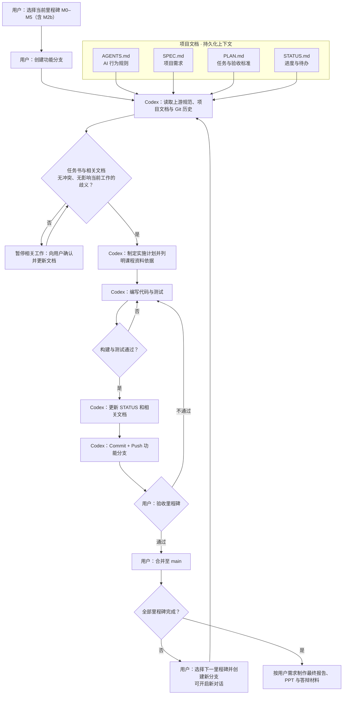

# AGENTS.md — Codex 工作协议

本仓库是《并行与分布式计算》期末大作业：二维热传导方程显式有限差分的串行与并行求解。使用者独立完成项目管理、审核和答辩；Codex 负责在授权范围内实现、验证、记录与提交。

## 1. 资料与规则

1. 教师原始任务书（位于本地 `docs/sources/final.pdf`）是课程要求的权威来源。
2. `docs/sources/` 中同时存储了课程讲义 `lectures/` 与参考代码 `examples/`及PPT制作可以参考的`PPT模板/`，项目实现需要关注课程资料聚焦的细节问题。整个资料目录仅限本地只读使用，禁止编辑、移动、删除或纳入 Git；新克隆需由使用者从课程原始资料补齐。
3. `SPEC.md` 定义项目范围、需求及验收标准；尚未核准的要求不能视为已冻结。
4. `PLAN.md` 定义阶段与进入条件；`STATUS.md` 记录实际状态和下一步。
5. `docs/DESIGN.md` 解释数学模型、数值算法和并行设计；`docs/DECISIONS.md` 记录重要取舍及理由。
6. 代码和真实运行输出是实现及测试结果的最终证据，文档描述不能代替验证。

资料冲突时停止相关实现，指出冲突并请求用户裁决；不要凭猜测修改教师要求。

## 2. 每次开始工作

先检查仓库根目录、当前分支、`git status` 和最近提交；再阅读 `SPEC.md`、`PLAN.md`、`STATUS.md` 及本次任务涉及的设计文件。

开始编码前报告：当前里程碑、拟修改文件、验收标准、已存在的未提交修改及风险。一次只处理用户确认的当前任务；禁止自行扩展到下个里程碑。

## 3. 通用开发流程

## 4. Git 权限边界

* 用户创建/切换功能分支，决定里程碑是否通过，并负责合并到 `main`。
* Codex **可以**在当前已确认的功能分支内实现、运行检查、逐项暂存、提交并推送到**同名远程功能分支**。
* 位于 `main`、分支不明、存在与任务无关的改动或合并冲突时，不得自动提交/推送，先报告并等待处理。
* 禁止自行切换、创建、删除分支；禁止直接推送或合并 `main`、强制推送、改写历史、`git reset --hard`、`git clean` 等破坏性操作。
* 禁止使用不加检查的 `git add .`；提交前检查 `git diff --cached`，仅包含本任务文件；不得提交密钥、个人配置、构建产物或无关文件。
* 每个提交应描述可独立验证的一项修改。测试未通过时可以保留工作区改动，但不得伪称里程碑已通过。

## 5. 实现与验证要求

* 优先使用可重复的构建和测试命令（已确认采用 C++17、CMake/CTest）。执行顺序为：保存 → 构建 → 测试 → 记录。
* 已确认必做独立串行、MPI 和 OpenMP 求解器，按 M1 串行 → M2 MPI → M2b OpenMP → M3 系统验证 → M4 性能实验推进。MPI、M2b OpenMP 与 M3 系统验证已验收；混合并行不在当前范围，扩展需用户另行确认。在相同 `N, M, T, α`、边界条件与精度标准下比较三种实现。
* 显式差分满足 `r = αΔt/h² ≤ 1/4`。新旧时间层分开存储，避免在同一时间步读到已更新值。
* 测试应涵盖解析解误差、网格加密趋势、串并行一致性，以及可用并行度下的边界情形。
* MPI 必须关注邻居通信、halo/ghost 数据、进程划分、所有 rank 一致的错误处理和正常退出。
* OpenMP 必须说明内部行在线程间的划分、共享双缓冲与线程私有变量，确保每个内点仅由一个线程写入；整层更新完成后统一交换缓冲并同步，再进入下一步，避免数据竞争。MPI 进程数记为 P，OpenMP 线程数记为 Q，记录请求值与实际使用值；不得把 MPI 的 P≤N-1 限制套用于 OpenMP。
* 性能实验必须真实运行：记录机器、编译器、编译选项、问题规模、线程/进程数、计时范围与重复次数；不编造时间、加速比、测试日志或截图。
* 无法执行某项检查时明确写“未运行/待验证”及原因，不得写 PASS。

## 6. 每轮收尾与上下文接续

完成一项任务后：

1. 汇报修改范围、真实构建/测试命令及结果，指出未解决问题。
2. 更新 `STATUS.md`：当前阶段、已验证事实、阻塞、下一步。
3. 涉及技术取舍时更新 `docs/DECISIONS.md`；使用 AI 的关键环节和人工核查记录写入 `docs/AI_USAGE.md`。
4. 在满足第 3 节条件时完成 Git commit/push，汇报提交哈希及远程分支；未提交则解释原因。

开启新对话后，必须先从上述仓库文件与 Git 状态恢复事实；历史聊天仅作辅助，不能代替当前仓库状态。
