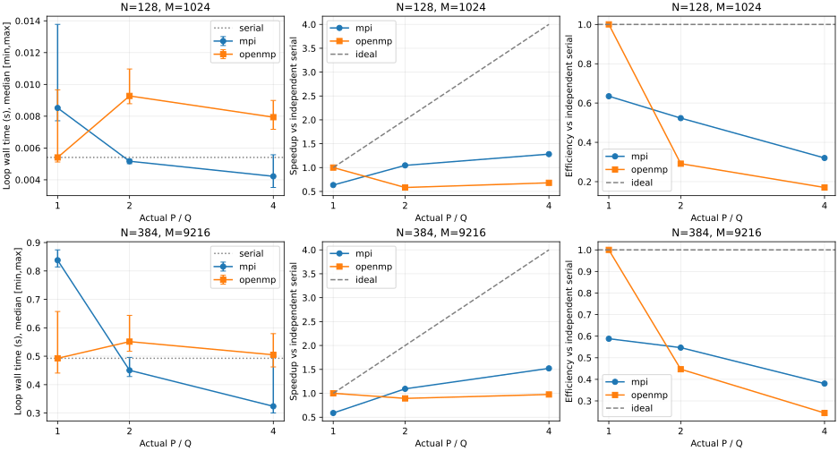
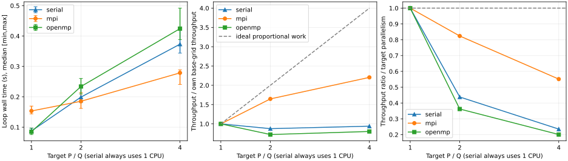

# M4 性能实验结果（2026-11-11，待用户验收）

本次在冻结版本 `75cdaad9a71ef3373bd8d7ea441ae2ad3d3a9732` 上完成 23 个配置、23 次完整场验证预热及 115 条正式计时样本，每配置五次，无失败、无重试、无离群值删除。采样期间源码、协议和二进制 SHA-256 前后不变；起始工作区干净。结果限于本轮单机 WSL2、CPU 0/2/4/6 绑定、Release 配置与循环计时范围，不代表其他机器或端到端表现。

协议与完整定义见 [README](README.md)、[protocol.json](protocol.json)。原始证据在 [samples.jsonl](run-01/samples.jsonl)、[metadata.json](run-01/metadata.json)、[environment.log](run-01/environment.log) 和 [complete.json](run-01/complete.json)。采样日历时间记录为 Asia/Shanghai 2026-11-11 09:25:29 至 09:26:42（原始 UTC 时戳有回退现象，不能由两端相减确定总耗时，详见后文时钟核查）。所有表格来自 [summary.csv](derived/summary.csv)，下表仅显示舍入值，不用显示值反算加速比。

## 正确性与计时核查

Debug/Release 完整回归各 20/20，通过原有 M1–M3 及新增计时/摘要测试；Debug 在最终测试控制逻辑后补跑 heat_timing 1/1。命令、真实输出、同次 XML 与四位小数核对见 [m4.log](../validation/m4.log)。统计方法合成单元检查独立通过，八类损坏数据均拒绝；合成数字没有进入采样目录或性能表。

正式矩阵全场验证观测 D_inf 全部为 0，独立连续解析 E_inf 为 8.314784308849354e-7 至 7.4838110496466825e-6，离散正弦模态最大差 2.3381296898605797e-13；严格零边界与字段顺序通过。每个正式样本的实际 P/Q 等于请求值、参数/稳定性通过，E_inf 与该配置完整场验证差小于 1e-14。判据与容差依据见协议，不将一次零差扩大为任意输入逐位相同的保证。

MPI 每次保存 rank 绑定，预热 OpenMP Q=2/4 的运行时 affinity 诊断分别确认 CPU 0/2、0/2/4/6。libgomp 对 Q=1 的串行化团队未输出 affinity 行，故采样后另用同环境 Q=1 的真实求解作独立 /proc 探针：进程最终亲和性 CPU 0、一个 task，摘要实际 Q=1，证据及完整探针源码在 [binding-probe.json](run-01/binding-probe.json)。该额外调用只验证绑定，不纳入 115 条计时样本。环境探测的 13 个命令均正常退出。

## 固定规模强扩展

T=0.01、alpha=1、r=0.16；每个表固定 N/M，p 列为已核查相等的请求/实际资源数（MPI 为 P，OpenMP 为 Q，serial 恒为 1）。Ts 为该表同一独立串行程序五次样本的中位数。S=Ts/Tp，E=S/p，MPI P=1 与 OpenMP Q=1 均未替换 Ts。时间列单位为秒，范围为五次样本最小/最大，不是置信区间。

### N=128，M=1024

| 实现 | 请求/实际 p | 中位数 s | 最小–最大 s | S | E |
| --- | --- | --- | --- | --- | --- |
| serial | 1 | 0.005406863 | 0.005138416–0.006610494 | 1.0000 | 100.00% |
| mpi | 1 | 0.008518696 | 0.007710637–0.013776413 | 0.6347 | 63.47% |
| mpi | 2 | 0.005166211 | 0.005012536–0.005284385 | 1.0466 | 52.33% |
| mpi | 4 | 0.004217559 | 0.003514440–0.005571511 | 1.2820 | 32.05% |
| openmp | 1 | 0.005404862 | 0.005117919–0.009659399 | 1.0004 | 100.04% |
| openmp | 2 | 0.009274439 | 0.008785304–0.010970525 | 0.5830 | 29.15% |
| openmp | 4 | 0.007938000 | 0.007176585–0.008990959 | 0.6811 | 17.03% |

### N=384，M=9216

| 实现 | 请求/实际 p | 中位数 s | 最小–最大 s | S | E |
| --- | --- | --- | --- | --- | --- |
| serial | 1 | 0.492738995 | 0.489257825–0.519114704 | 1.0000 | 100.00% |
| mpi | 1 | 0.837809986 | 0.814163430–0.874222782 | 0.5881 | 58.81% |
| mpi | 2 | 0.450466401 | 0.428662195–0.495735271 | 1.0938 | 54.69% |
| mpi | 4 | 0.323863468 | 0.300284119–0.498359098 | 1.5214 | 38.04% |
| openmp | 1 | 0.492711140 | 0.440762608–0.657457051 | 1.0001 | 100.01% |
| openmp | 2 | 0.551399318 | 0.517501600–0.643751093 | 0.8936 | 44.68% |
| openmp | 4 | 0.504976575 | 0.462348245–0.579582887 | 0.9758 | 24.39% |



### Amdahl 分析与实现差异

在这两组实际范围内，MPI 中位数随 P=1→2→4 下降，但相对独立串行的收益有限：小组 P=4 为 1.282 倍/32.05%，大组为 1.521 倍/38.04%。扩大固定问题改善了 MPI 的主基线效率，但没有接近理想四倍。尤其 MPI P=1 比独立串行慢，说明不能用同一 MPI 程序的 P=1 基线来替代本项目要求的独立 Ts；例如大组若误用 MPI P=1，会得到约 2.587 倍，与本表的 1.521 倍含义不同。

OpenMP 小组 Q=2/4 均慢于独立串行，大组 Q=4 的中位数也略慢（S=0.976），Q=4 比 Q=2 快不能推导出其优于串行。大组 serial 的范围为 0.489258–0.519115 s，Q=4 为 0.462348–0.579583 s，范围重叠；仅凭五次样本不能将约 2.4% 的中位数差声称为稳定的普遍退化或统计显著差异。小规模只有约 5 ms 的串行循环，调度/同步与系统抖动更易影响相对值。扩大工作并未在本轮 OpenMP 实现/绑定环境中带来主基线加速，保留这一结论，不为获得加速修改协议或筛选样本。

Amdahl 的理想模型 `S(p)=1/[f+(1−f)/p]` 解释固定规模中的不可并行部分限制，但本测量还包含通信、同步、边界处理、内核检查和系统环境效应。以主基线反推的有效 f 如下，仅作模型诊断：

| N | 实现 | p=2 的 f_eff | p=4 的 f_eff |
| --- | --- | --- | --- |
| 128 | mpi | 0.9110 | 0.7067 |
| 128 | openmp | 2.4306 | 1.6242 |
| 384 | mpi | 0.8284 | 0.5430 |
| 384 | openmp | 1.2381 | 1.0331 |

同一规模不同 p 的有效 f 不恒定，OpenMP 还出现 f_eff>1，已超出理想串行比例 [0,1] 的意义。不能将这些数当成源码中的串行占比，也不能据此预测无限核心的极限加速。MPI 存在每步两次 halo 通信，OpenMP 存在每步两处必要同步；它们与缓存访问、行分配、运行时调度和非独占 WSL 环境共同影响实际时间。这里没有通信/屏障分项剖析、硬件计数器或宿主调度证据，因此这些是可解释因素，不把某一因素断言为已量化的主要瓶颈；效率下降也不能解释为 CPU 利用率数值。

## 随并行度扩大累计工作量

固定物理域、T=0.01、alpha=1。N/M=256/4096、304/5776、362/8191 对应目标 p=1/2/4；前两组 r=0.16，最后 r=0.15998534977414236。`W=M(N−1)²`，实际 W/W1=1、1.991004、4.007846，平均 W/p 与基础配置的偏差约 0、−0.4498%、+0.1961%。最小/最大 worker 累计更新量在 summary.csv 中逐配置记录，行数取整影响没有省略。

以下 S/E 仍对照**相同规模**的独立 serial；R 则是各实现相对其**基础网格自身 p=1**的吞吐增长，`R=(W/W1)*Tp1/Tp`。R/p 是考虑实际累计更新量的归一化扩展指标，不能与主基线 E 混用。serial 始终只用 1 CPU，其 R/目标p 仅作为参考曲线，非串行程序的并行效率。

| N/M | 实现 | 目标 p / 实际 p | 中位数 s | 同规模 S | 同规模 E | 吞吐增长 R | R/目标p |
| --- | --- | --- | --- | --- | --- | --- | --- |
| 256/4096 | serial | 1/1 | 0.087637928 | 1.0000 | 100.00% | 1.0000 | 100.00% |
| 256/4096 | mpi | 1/1 | 0.153427945 | 0.5712 | 57.12% | 1.0000 | 100.00% |
| 256/4096 | openmp | 1/1 | 0.085112884 | 1.0297 | 102.97% | 1.0000 | 100.00% |
| 304/5776 | serial | 2/1 | 0.199068639 | 1.0000 | 100.00% | 0.8765 | 43.83% |
| 304/5776 | mpi | 2/2 | 0.185396790 | 1.0737 | 53.69% | 1.6477 | 82.38% |
| 304/5776 | openmp | 2/2 | 0.233925497 | 0.8510 | 42.55% | 0.7244 | 36.22% |
| 362/8191 | serial | 4/1 | 0.373278894 | 1.0000 | 100.00% | 0.9410 | 23.52% |
| 362/8191 | mpi | 4/4 | 0.278834889 | 1.3387 | 33.47% | 2.2053 | 55.13% |
| 362/8191 | openmp | 4/4 | 0.424428030 | 0.8795 | 21.99% | 0.8037 | 20.09% |

扩大工作量所有最小/最大样本范围、请求/实际 P/Q、W/p、吞吐和完整精度数值见 summary.csv；不隐去 scaled OpenMP Q=1 的 S≈1.030、E≈103.0%。这是两个独立运行程序的有限样本比率，且误差范围重叠，不能当作单线程并行效率突破的普遍事实。



### Gustafson 分析与稳定性约束

从基础到目标 p=4，MPI 总工作量增加至 4.007846 倍，时间从 0.153428 s 增至 0.278835 s；吞吐增长 2.2053 倍，归一化指标 55.13%，相同大规模独立串行基线的 S=1.3387、E=33.47%。OpenMP 时间从 0.085113 s 增至 0.424428 s，吞吐增长仅 0.8037 倍，归一化指标 20.09%；同规模 S=0.8795、E=21.99%。MPI 体现了部分吞吐扩展，但两者均未做到随工作量扩大而保持恒定推进时间。不同规模串行程序自身的更新吞吐也变化，因此不能只按 W 比例推算串行耗时，必须使用本轮同规模实测 Ts。

Gustafson `S_G=p−sigma(p−1)` 说明：若扩展时保持相近并行时间且该时间中的串行占比较小，扩大可并行工作可提高有效加速。本轮按 W≈pW1 设计，工作量增长控制在不到 0.5% 的取整偏差内，但实际时间没有保持恒定，尤其 OpenMP 的同步/调度等额外成本并未被更大工作抵消。没有单独测量 sigma，不能以公式拟合虚构串行时间占比或声称已实证 Gustafson 线性加速；本轮数据展示了该理想前提的实际局限。

二维稳定性要求 `M≥4*alpha*T*N²`。若只按 N²∝p 增加节点并维持固定 T/r，M 也近似随 p 增长，累计 W 会接近 p²，不能称每 worker 工作恒定。本轮采用 N∝p^(1/4)、M∝N²，使累计 W 近似线性增长；节点数/worker 本身无需恒定。由于 W/p 仍有取整偏差、通信量/同步次数和数据尺寸变化，本文明确称扩大工作量实验，并报告实际累计更新量，未将其笼统视为理想弱扩展。

## 证据复现与边界

```bash
python3 tests/check_statistics.py
python3 scripts/analyze_performance.py docs/performance/run-01 --output build/m4-recomputed --no-plots
cmp docs/performance/derived/summary.csv build/m4-recomputed/summary.csv
# 重画可选择新的输出目录；不改动 run-01 原始样本：
python3 scripts/analyze_performance.py docs/performance/run-01 --output build/m4-replotted
```

独立输出目录重算 CSV 已逐字节一致；SVG/PNG 已目视核对标题、坐标、图例和范围条，理想线有明确标注，非观测数据。采样采用固定种子逐轮交错，未与本项目构建/CTest 重叠；五次样本的波动全部保留，不提供未计算的置信度或显著性结论。没有测量 P/Q>4、多机、不同绑定/调度策略、端到端性能、额外 Sanitizer、CPU 频率控制或分项性能剖析，也不把这些写为通过。

初始 /tmp 资料哈希基线在跨环境恢复后丢失，无法完整比较开工至收尾的所有资料；恢复后的 2,564 文件基线一致、课程资料始终只读且未进入 Git。来源保护核查的限制与归档修正已写入 STATUS、AI_USAGE 和 m4.log。本轮仅完成 M4 实施，验收与合并由用户决定，不进入 M5 报告/PPT。


### UTC 时间戳异常与耗时时钟核查

最终审计发现两处相邻调用的 UTC 起点差小于前一调用的 perf_counter 耗时（配置 18 预热、配置 15 第三次采样），差值分别约 −1.6631 s、−2.0152 s；后一处下一条 UTC 起点本身比上一条更早。这些差值是时钟不一致的观测，不等于已测定的精确校时幅度；未推断宿主校时或 NTP 的具体原因。原始时间戳/样本全部保留，不据 UTC 推断作业重叠，也不把始末 UTC 差当总耗时。

额外核对本机实际 libmpi/libgomp/libstdc++ 二进制：MPI_Wtime、omp_get_wtime 和 steady_clock::now 的正常路径均向 clock_gettime 传入 1，本机 Linux 头文件定义 CLOCK_MONOTONIC=1；libgomp 仅在该调用失败时有 CLOCK_REALTIME 回退分支，没有观测到此类失败。反汇编原始命令、输出、运行时库哈希与两处 UTC 异常记录见 [clock-audit.log](run-01/clock-audit.log)。计时来自本地耗时差而非 UTC 起点，时戳回退本身不能证明循环耗时失效；保留全部原始结果和环境局限，不将其删除以美化图表。

同一采样脚本逐个阻塞等待 process.communicate()，返回并完成检查后才调用下一配置，因此程序组织是顺序的；未保存每个调用的独立单调起点时间线，不能声称已由时戳独立重建了无重叠过程。此处通过冻结源码及实际记录解释证据边界，未将日历时间异常掩盖为正常。
