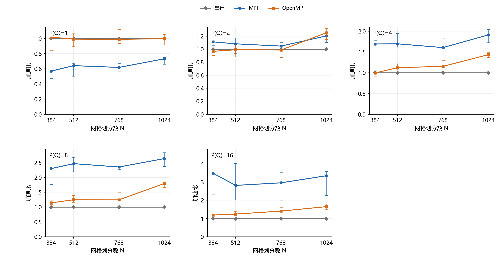

# 二维热传导方程的串行、MPI与OpenMP求解

《并行与分布式计算》2026年秋季学期期末大作业 · 第4题
姓名：待填写　学号：待填写　日期：2026-11-15

## 摘要

本项目计算一块四边保持零温度的单位正方形薄板，在给定初始温度分布后，经过一段时间的温度如何变化。使用者输入网格划分数、时间步数、终止时刻和热扩散率，程序输出终止时刻每个网格点的温度、与解析解的误差以及数值推进耗时。项目先完成独立串行求解，再增加MPI多进程与OpenMP多线程两种方式；三者求解同一个问题，改变的是计算分工与数据交换方式。

已有检验表明，在同一输入下，串行和并行结果满足既定误差要求；网格间距减半、时间步长缩为四分之一时，默认测试组的最大解析误差约缩为四分之一。最大性能测试网格N=1024、M=65536时，独立串行推进中位耗时35.3892秒，MPI16为10.5662秒、加速比3.3493；OpenMP8为19.6692秒、加速比1.7992，OpenMP16为21.4382秒。增加执行单元或网格数量并不保证加速比持续提高。

性能测试包括三批实验：原实验23配置/115正式样本，隔离诊断01为215预热/2560正式调用，扩大实验02-r1为44预热/440正式样本。正式性能始终使用原三个程序。非独占WSL环境、硬件线程共享、轮次趋势和未校准外部物理时间限制了结论的推广；以下分别说明求解方法、正确性检验和性能测试结果。

## 1. 问题与程序功能

### 1.1 求解任务与功能

本项目求解单位正方形薄板在正弦初始温度、四边零温度条件下的瞬态温度场。区域与初边值固定，程序接受网格划分数N、时间步数M、终止时刻T及热扩散率alpha，输出T时刻的全场数值解与误差。

| 求解方式 | 提供的功能 | 计算如何分工 |
| --- | --- | --- |
| 独立串行 | 输出完整温度场、误差和推进耗时，提供比较基准 | 一个执行流程逐行完成全部计算 |
| MPI多进程 | 在相同输入下并行计算，最后由主进程输出完整温度场 | 每个进程保存并更新一段连续行，每步向邻进程交换所需温度 |
| OpenMP多线程 | 在相同输入下并行计算，并报告请求与实际线程数 | 多个线程共享温度数组，按行分工，每步完成后同步换层 |

三种方式采用相同的五点显式差分算法、初边值和精度要求，输出同一网格、同一终止时刻的温度场。

### 1.2 输入参数

| 输入 | 含义 | 默认值与要求 |
| --- | --- | --- |
| `--N` | 每个空间方向等分的区间数；越大则网格越细 | 20；整数N≥2，每方向有N+1个节点 |
| `--M` | 从0推进到T所用的时间步数 | 400；整数M≥1，还须满足第2节稳定性条件 |
| `--T` | 希望计算到的终止时刻 | 0.1；有限正数 |
| `--alpha` | 热扩散率 | 1；有限正数 |
| MPI启动进程数P | 参与计算的进程数量 | 由启动命令指定；本实现要求1≤P≤N−1 |
| OpenMP的`--threads Q` | 请求参与计算的线程数量 | 默认1；正整数，实际线程数可能受运行时限制 |

三程序使用相同的四个数值参数。MPI实际进程数由运行时通信组的大小读取；OpenMP分别报告请求Q与实际团队大小，不能用请求值代替实际并行度。不稳定参数、非法输入或超出可表示数组规模的输入会被拒绝；规模可表示仍不保证机器有足够内存。

### 1.3 输出与计算结果

正常运行时，标准输出给出终止时刻T的全场CSV，可保存为文件后逐点比较；标准错误输出给出参数、解析误差和推进耗时等摘要。CSV包含以下七列。

| 字段 | 内容 |
| --- | --- |
| `i,j` | 网格点的行、列编号 |
| `x,y` | 该点在单位薄板上的坐标 |
| `u_numeric` | 从初值逐步计算得到的温度 |
| `u_exact` | 同一点、同一终止时刻的解析温度，作为检验参考 |
| `abs_error` | 该点数值温度与解析温度之差的绝对值 |

例如默认N=20、M=400、T=0.1、alpha=1时，输出包含21×21=441个网格点；验证得到的最大解析误差为1.126210917414272e-4。它说明这组离散参数下的精度，不能当成任意输入均满足的误差上限。更细网格的误差变化见第4节。

摘要中的`E_inf`是所有点的最大解析误差，`loop_seconds`是第5节定义的数值推进耗时。选择`--summary-only`可省略全场CSV，仍进行数值推进与验证，MPI也仍收集结果。该选项改变输出量，不改变所求问题或算法。

### 1.4 项目范围

本项目采用C++17实现独立串行、MPI与OpenMP三种求解程序，使用CMake构建和CTest测试。三种方式均采用题设的五点显式格式与双数组推进，比较相同问题下的结果和运行速度。研究范围限于单机上的这三种实现，不包含MPI与OpenMP混合并行、隐式算法或将诊断变体替换为正式求解器。

## 2. 数学模型与数值算法

### 2.1 模型与均匀网格

温度场u(x,y,t)满足以下初边值问题，区域Ω=(0,1)²：

$$
u_t=\alpha(u_{xx}+u_{yy}),\qquad (x,y)\in(0,1)^2,\qquad 0<t\le T,
$$

$$
u|_{\partial\Omega}=0,\qquad u(x,y,0)=\sin(\pi x)\sin(\pi y).
$$

连续解析解用于终止时刻的误差检验：

$$
u(x,y,t)=e^{-2\alpha\pi^2t}\sin(\pi x)\sin(\pi y).
$$

程序实际从初值逐步推进，不用解析终值替代求解；解析解用于推进后的误差检验。

在x、y两个方向各等分N个区间，网格间距h=1/N；令 $x_i=ih,y_j=jh$，其中 $0\le i,j\le N$。总节点数为 $(N+1)^2$，去掉四边后需要更新的内部节点数为 $(N-1)^2$。本实现将i作为行/x方向、j作为列/y方向。时间也均分为M步，步长 $\Delta t=T/M$，时间层 $t_n=n\Delta t$。默认N=20时h=0.05，M=400、T=0.1时Δt=0.00025，程序恰好推进400次到T。

### 2.2 五点显式差分

以 $U_{ij}^n$ 记离散温度，采用时间向前Euler、空间中心差分：

$$
\frac{U_{ij}^{n+1}-U_{ij}^{n}}{\Delta t}
=\alpha(\frac{U_{i-1,j}^{n}-2U_{ij}^{n}+U_{i+1,j}^{n}}{h^2}
+\frac{U_{i,j-1}^{n}-2U_{ij}^{n}+U_{i,j+1}^{n}}{h^2}).
$$

整理后得到五点显式格式：

$$
U_{ij}^{n+1}=(1-4r)U_{ij}^{n}+r(U_{i-1,j}^{n}+U_{i+1,j}^{n}+U_{i,j-1}^{n}+U_{i,j+1}^{n}),
\qquad r=\frac{\alpha\Delta t}{h^2}.
$$

更新读取旧层的五个值，并写入新层同一节点，数据依赖如下。

| 读取的旧层位置 | 在新温度中的权重 |
| --- | --- |
| 中心(i,j) | 1−4r |
| 上下两点(i−1,j)、(i+1,j) | 每点r |
| 左右两点(i,j−1)、(i,j+1) | 每点r |
| 写入位置 | 新层的同一节点(i,j) |

边界节点保持零，离散格式总体一致性为 $O(\Delta t+h^2)$。

### 2.3 双数组与时间推进

本实现使用old与next两份数组，推进期间old只读、next只写；整层完成后交换角色，保持五点格式的旧层依赖。

完整求解顺序为：

1. 检查参数及稳定性，分配两份温度数组；按正弦初值设置旧层，四边取零。
2. 保持旧层只读，用五点公式逐点填写新层的全部内部节点，新层四边仍取零。
3. 等整层完成后交换两数组的角色，让刚完成的新层成为下一步的旧层；交换角色不需要逐点复制全场。
4. 重复第2、3步，累计恰好M次，得到T时刻温度；最后计算误差并输出。

奇数步、偶数步结束后均输出实际最终层。程序按整数步数控制结束，不靠不断累加浮点时间判断是否达到T。串行与OpenMP各保存两份完整温度场；MPI保存局部行与邻接行副本，详见第3节。每份完整double数组约占 $8(N+1)^2$ 字节，双数组约占 $16(N+1)^2$ 字节。累计内部节点更新量定义为 $W=M(N-1)^2$，用于比较工作量，单位是更新次数，并非浮点运算次数。

### 2.4 稳定性与参数校验

本题采用的稳定性条件为

$$
0<r=\frac{\alpha\Delta t}{h^2}\le\frac{1}{4},
\qquad \Delta t\le\frac{h^2}{4\alpha}.
$$

网格加密测试按各组固定的T、alpha与r选取M；02-r1取r=0.16。离散最大值原理用于全场检查。

傅里叶放大因子为

$$
G=1-4r[\sin^2(\theta_x/2)+\sin^2(\theta_y/2)].
$$

按 $|G|\le1$ 选取二维稳定上限。参数检查以long double中间值严格比较r与0.25，超限输入直接拒绝。

## 3. 串行与并行实现

### 3.1 独立串行基线

串行方式由一个执行流程完成第2节的全部步骤。每步检查两数组的大小和是否意外使用了同一个数组，将新层四边清零，再按行计算所有内点，整层结束后交换数组角色。它输出的完整温度场用于核对并行结果，推进耗时记作Ts。

对应程序名为`heat_serial`，单独构建且不链接MPI或OpenMP；参数验证和输出可以与并行程序共享辅助代码，但数值推进走独立串行路径。MPI仅用一个进程、OpenMP仅用一个线程，仍带有各自的数据布局和运行时成本，因此它们的耗时不能替代Ts。后面所有正式加速比都使用相同输入的独立串行时间作为基线。

### 3.2 MPI行分块与邻接行交换

MPI实现将内部行连续分配给P个进程，每步先交换子区上下邻接行，再更新本区内点。

例如N=8时共有7个内部行，P=3时分成3、2、2行。进程0负责全局行1–3，进程1负责4–5，进程2负责6–7，每行均保留N+1列。进程1更新第4行时，需要进程0的旧第3行；更新第5行时，需要进程2的旧第6行。每个子区的新旧数组均在拥有行上下各设置一行halo，保存邻区旧层数据；物理边界单独置零。

一般地，设K=N−1个内部行、P个进程，进程编号（rank）为p，从0开始。令 $q=\lfloor K/P\rfloor$，$s=K\bmod P$，先每进程分q行，再给前s个进程各加一行：

$$
m_p=q+[p<s],\qquad o_p=pq+\min(p,s).
$$

其中[p<s]在条件成立时为1，否则为0；m_p为拥有行数，o_p为前面进程拥有的总行数。进程p拥有全局行 $o_p+1$ 至 $o_p+m_p$，局部行k对应全局行o_p+k。本地每份新旧数组大小为 $(m_p+2)(N+1)$；初始化使用全局坐标，不把每个子区当作独立单位薄板。

每个时间步依次完成以下操作：

1. 将薄板最上、最下物理边界对应的halo置零；内部子区的halo等待邻居数据。
2. 向上邻居发送首个拥有行，同时从下邻居接收底部halo；再向下邻居发送末个拥有行，同时从上邻居接收顶部halo。两次传输均使用完整旧层行。
3. 邻接数据到齐后，用五点公式更新本进程拥有的内点，左右边界置零，再交换本地数组角色，进入下一步。

代码用两次`MPI_Sendrecv`配对发送与接收，标签分别为71、72，避免所有进程先作阻塞发送造成的典型死锁。没有邻居的端部以`MPI_PROC_NULL`表示，它不会替程序把接收缓冲置零，所以物理边界须自行维护。每步没有额外全局屏障，邻居数据依赖由上述通信完成。

本实现要求1≤P≤N−1，让每个进程至少拥有一行；这是本项目实现限制，不是MPI普遍限制。还会提前检查MPI传统int计数与位移范围。推进结束后，由`MPI_Gatherv`将各段结果收集到主进程，重建完整场，并核对收集场的解析误差与各进程归约误差一致。分配状态通过`MPI_Allreduce`协调，输入和输出错误沿一致路径退出，通信错误调用`MPI_Abort`；这些处理不覆盖真实进程丢失、强制终止或系统耗尽内存后杀进程等情况。

### 3.3 OpenMP行分配与同步

OpenMP实现共享两份完整温度场，每个内点仅由一个线程写入，旧层只读；全部M步由同一个持续线程团队完成。

本项目按整行轮转分配任务：设实际团队大小为A，线程编号t从0开始，线程t负责1+t、1+t+A等内部行。例如N=7、A=4时，6个内部行分为{1,5}、{2,6}、{3}、{4}。对应实现是`omp for schedule(static,1)`，与MPI的连续行分块不同；诊断中测试过的连续行变体未进入正式程序。

每个时间步采用以下同步顺序：

1. 各线程按五点格式更新分到的新层行。
2. 所有线程在第一道屏障等待，确认整层写入均已结束。
3. 由一个线程交换共享新旧数组的角色。
4. 所有线程经过第二道屏障，确认交换已完成后，才进入下一步。

实现中，行循环结束处的隐式屏障承担第2步，`single`区域负责交换，其末尾隐式屏障承担第4步；两处均未使用`nowait`取消等待。若只删去交换后的屏障，其他线程可能在交换尚未完成时开始下一步，读到错误的时间层。两数组的四边初始化为零，以后不再写边界。

全部M步由一个持续的线程团队完成，而非每步重新进入并行区。两份数组和实际团队数共享，N、M、行宽与r通过`firstprivate`提供各线程的只读副本，循环下标和点索引为线程私有，`default(none)`要求明确数据属性。入口关闭动态调整并显式请求Q，在实际推进团队内读取A；运行时限制仍可能使A<Q。Q>N−1合法，部分线程虽无行可算，也须参与同步，不能套用MPI的进程数上限。线程创建失败可能由运行时直接非零退出，不声称C++异常处理能捕获所有运行时错误。

## 4. 正确性检验

### 4.1 测试数据与参考结果

在相同N、M、T、alpha、初边值与精度要求下，分别采用连续解析解、独立串行场和离散正弦模态构造参考结果。

| 检验 | 参考结果构造 | 检验对象 |
| --- | --- | --- |
| 连续解析误差E_inf | 在每个网格坐标代入题设解析解，取终止时刻T的温度 | 离散解与连续问题的偏差 |
| 串并行差D_inf | 先用独立串行程序得到同输入的最终全场，再与MPI/OpenMP逐点比较 | 通信、分工及同步是否改变了计算结果 |
| 离散正弦模态误差 | 利用本题正弦初值在离散格式中的已知衰减率，独立构造推进M步后的参考场 | 时间步数、最终数组及离散更新是否正确 |

前两类最大误差分别定义为

$$
E_\infty=\max_{i,j}|U_{ij}^M-u(x_i,y_j,T)|,
\qquad D_\infty=\max_{i,j}|U_{ij,\mathrm{parallel}}^M-U_{ij,\mathrm{serial}}^M|.
$$

第三类参考为 $U^0g^M$，其中 $g=1-8r\sin^2(\pi/(2N))$，U^0是按初值构造的网格场。E_inf、D_inf与模态误差分别判定，使用独立的精度标准。解析解和离散模态只作检验参考，不替代求解器的逐步推进。

### 4.2 网格加密结果

在系统验证中，固定T、alpha和r，每次将N加倍、M增为四倍，构造r=0.05/0.1/0.25三组加密测试。下表为默认组T=0.1、alpha=1、r=0.1的真实记录，取Debug独立串行数据；Debug/Release及同输入各实现的解析误差一致。

| N | M | E_inf | 前层/本层误差比 | 观测阶 |
| ---: | ---: | ---: | ---: | ---: |
| 20 | 400 | 1.126210917414272e-4 | — | — |
| 40 | 1600 | 2.818135112095388e-5 | 3.996299 | 1.998664 |
| 80 | 6400 | 7.046962600038009e-6 | 3.999078 | 1.999667 |

网格间距减半时，误差约减为四分之一，观测阶接近2。这与 $O(\Delta t+h^2)$ 在Δt∝h²下的联合二阶趋势一致，不表示时间离散达到了二阶。测试参数组避开r≈1/12附近的主误差抵消，回归采用约3.8–4.2的误差比区间，解析误差上界根据所选模态渐近式留出余量；它们是本组测试的判据，不是任意输入的精度定理。

### 4.3 边界情况与回归结果

除上述加密测试外，小网格用非对称数据构造可手算的单步结果，防止对称初值掩盖方向或索引错误；同时检查旧层不被修改、初值和严格零边界、奇偶步返回的最终数组。并行测试覆盖MPI不均匀分块、每进程一行、超限进程数，以及OpenMP线程多于内部行、请求4但实际2等情况。输入测试包含r=1/4、相邻浮点超限值、非法输入；错误路径还覆盖输出失败、受控分配/通信故障和超时。

小规模串并行差容差为1e-13，正式大规模验证为1e-12。扩大实验02-r1的完整场预热观测到最大D_inf=0，离散模态最大差6.638023464233811e-13，连续E_inf约1.1693e-7至8.3148e-7。观测零差只说明已测配置的结果，不能外推任意规模逐位一致。正式计时样本不保存大场作为性能数据，保留验证摘要与输出哈希。

系统验证在Debug与Release构建下均通过19项测试；加入计时接口后，两种构建均通过20项回归测试，启用隔离诊断时均通过21项。扩大实验还单独检查了8/16进程或线程的资源使用、输出字段、统计计算和超时退出。上述测试覆盖范围不同，不能将某一组通过记录视为所有规模均已验证。

## 5. 性能测试方法

所有正式性能结果均以相同输入的独立串行推进时间Ts为基线，并行推进时间记为Tp。MPI采用实际进程数P、OpenMP采用实际线程数Q作为p，计算

$$
S_p=T_s/T_p,\qquad E_p=S_p/p.
$$

各固定规模配置分别重复计时，正式S采用串行与并行耗时中位数之比，原始样本全部保留。

### 5.1 硬件环境与编译配置

实验环境为单机WSL2、Intel i7-14700HX，来宾可见28逻辑CPU/14 core、约7.6 GiB内存；GNU C++13.3.0、Open MPI4.1.6、GNU OpenMP4.5/libgomp（软件包版本14.2）。Release统一C++17、-O3 -DNDEBUG，无fast-math、march=native或LTO，仅OpenMP链接-fopenmp。环境非独占，虚拟拓扑不证明宿主P/E核映射或物理核独占。

原矩阵绑定CPU0/2/4/6；02-r1扩至0,2,…,26,1,3所组成的集合，MPI/OpenMP同人数使用同集合。16执行单元为14个WSL可见core上的16逻辑CPU，含兄弟硬件线程，不能称16独立物理核心。MPI保存rank绑定报告，OpenMP记录实际团队及运行时诊断/任务亲和性快照；快照不等于连续监控。

### 5.2 计时范围

计时覆盖M步数值推进及其必要通信、同步与换层，具体边界如下。

| 程序 | 计时范围内 | 计时范围外 |
| --- | --- | --- |
| 串行 | M步：缓冲/参数检查、边界清零、内点更新、新旧数组交换 | 参数解析、分配、初值、解析验证与输出 |
| MPI | 每进程M步：物理边界halo清零、两次邻接行交换及等待、更新/换层；取各进程本地耗时最大值 | MPI启动与结束、参数广播、开始前全局屏障、计时/误差归约、全场收集、验证和输出 |
| OpenMP | 一次线程团队进入/退出、实际团队查询、M步更新、整层屏障、单线程换层及其后屏障 | 参数解析、分配、初值、验证和输出 |

串行steady_clock、MPI_Wtime和omp_get_wtime均按起止差读取；MPI不跨rank相减绝对时间。MPI最大值归约操作本身在范围外，但各rank测得推进耗时的最大值为样本。OpenMP进入/退出不意味着每次都新建/销毁操作系统线程。loop_seconds不是端到端耗时，也不是纯算术成本；CTest测试用时不能代替它。

### 5.3 实验批次与统计口径

三批实验目的不同：原实验建立基本性能比较；诊断01以隔离副本和对照变体探索原因；02-r1扩大网格与并行度，仍只测原三个正式程序。每个配置先完成含全场检查的预热，再进行正式计时。各批样本分别统计，预热与停止运行均不混入正式结果。

| 批次 | 预热/正式 | 统计对象 |
| --- | --- | --- |
| 原实验 | 23/115；23配置各5正式 | median(Ts)/median(Tp)，时间min/max |
| 隔离诊断01 | 215/2560；共2775调用 | 对照主要为10对耗时比率的中位数、配对bootstrap；含原路径复测等不同组 |
| 完成02-r1 | 44/440；44配置各10正式 | 同网格median(Ts)/median(Tp)，同轮共同bootstrap |
| 停止02 | 预热阶段停止；0正式 | 不进入完成数据统计 |

固定种子交错运行、预热全场验证，采样顺序执行，不与本项目构建/检查重叠；宿主其他活动无法排除。全部慢样本保留，无为美化结果的剔除。首次扩大运行02因单进程CPU绑定报告存在歧义而在预热阶段停止，未产生正式样本；核对实际绑定并修正报告解析后，以02-r1重新完成全部采样，不重用02的运行数据。

正式加速比 $S=\mathrm{median}(T_s)/\mathrm{median}(T_p)$，效率 $E=S/p$。诊断则先对每对对照耗时相除，再取这些比率的中位数；运算顺序不同，不能混作同一统计量。

时间min/max只是已测样本中的最小值与最大值，不是置信区间。为探索统计波动，02-r1对同轮串行/并行样本共同重采样10000次，每次重算中位数之比，给出bootstrap探索性95%区间；诊断重采样的对象则为配对比率。这些区间均未作多重比较校正，也不能自动消除环境随时间变化的影响或证明唯一原因。

## 6. 实测结果与解释

### 6.1 02-r1固定规模测试

先看最大网格N=1024、M=65536的完整求解任务：每个配置重复10次，得到以下推进耗时中位数。各并行配置均与该网格的独立串行比较。

| 执行方式 | 实际执行单元数 | 推进耗时中位数（秒） | 相对独立串行的加速比 |
| --- | ---: | ---: | ---: |
| 独立串行 | 1 | 35.389156603 | 1.0000 |
| MPI | 1进程 | 48.315583805 | 约0.7325 |
| MPI | 16进程 | 10.566213652 | 3.3493 |
| OpenMP | 8线程 | 19.669246715 | 1.7992 |
| OpenMP | 16线程 | 21.438211412 | 1.6508 |

MPI16将推进时间降至约10.57秒，效率为20.93%；OpenMP8与16的效率分别为22.49%和10.32%。MPI仅用一个进程反而比独立串行慢，说明各实现的单执行单元成本并不相同；OpenMP从8增加到16线程后，中位耗时上升。因此“使用更多执行单元”本身不能保证更快，耗时达到数十秒后仍存在差距，“任务太小”也不足以解释全部现象。

再看全部四个网格：N=384/512/768/1024，M=N²/16=9216/16384/36864/65536，固定T=0.01、alpha=1、r=0.16，每个网格均测实际P/Q=1/2/4/8/16。四组网格分别进行强扩展测试。下表按完整精度的统计结果计算后舍入展示，不用已舍入数反算S。

| N | MPI16 S | MPI16 E | OpenMP8 S | OpenMP16 S |
| ---: | ---: | ---: | ---: | ---: |
| 384 | 3.4885 | 21.80% | 1.1433 | 1.1894 |
| 512 | 2.8183 | 17.61% | 1.2491 | 1.2441 |
| 768 | 2.9596 | 18.50% | 1.2453 | 1.4063 |
| 1024 | 3.3493 | 20.93% | 1.7992 | 1.6508 |

图1：点为中位数之比，竖线为同轮bootstrap探索性95%区间。4面板各固定N/M；16执行单元包含14个WSL可见core上的兄弟线程。

MPI在四网格内随P增加，中位耗时均下降；但固定MPI16后，加速比随N变化并不单调，OpenMP16也不保证优于8。这里比较的是已测中位数，8/16直接比率未另建区间，不宣称所有运行都稳定优胜。图2把固定人数下的跨网格变化单独展示。

图2：每个点使用各自同网格独立串行基线。跨N同时增加M，W约随N⁴增长；这是联合加密/扩大工作量，不能称弱扩展，也不能把全部变化单独归因于每步粒度。

### 6.2 原实验：固定规模与随人数扩大工作量

原实验较小的固定网格提供另一组观察；它与02-r1使用不同批次的样本，分别报告，不能合并统计。另一条实验路径则是在增加人数的同时增加累计更新量，用来观察每个执行单元负担相近时，整体吞吐是否提高。

原固定N/M=128/1024时MPI4的S=1.2820、OpenMP4的S=0.6811；N/M=384/9216时分别为1.5214和0.9758。这些是原批次五样本中位数之比，不应与02-r1相同网格的新十样本合并。OpenMP4比2快，不等于它快于独立串行。

原扩大工作量随目标p=1/2/4采用N/M=256/4096、304/5776、362/8191，保持单位物理域、T=0.01、alpha=1，W/W1=1、1.991004、4.007846；W/p相对基础偏差约−0.4498%与+0.1961%。各配置还分别统计每进程或每线程的最小、最大实际更新量，以检查分工是否均衡。

定义相对各实现基础网格自身p=1的吞吐增长 $R=(W/W_1)T_{p1}/T_p$。到目标p=4，MPI R=2.2053、R/p=55.13%；OpenMP R=0.8037、R/p=20.09%。相同大网格独立串行基线对应的S分别为1.3387与0.8795；两类指标基线不同，不能混为效率。随规模增加，串行吞吐本身也变化，必须实测同网格Ts。

### 6.3 Amdahl与Gustafson分析

对原实验的固定规模配置，按Amdahl模型 $S(p)=1/[f+(1-f)/p]$ 反算 $f_{eff}=(p/S-1)/(p-1)$（p>1），所得值随p变化，OpenMP还出现大于1的值。结合MPI单进程慢于独立串行、隔离对照中行内核与行划分存在可重复影响等结果，常数串行比例不足以描述本实现的扩展表现；反算值包含实现差异、通信同步及环境影响，不作源码串行占比或无限并行度极限的估计。

原扩大工作量实验达到W≈pW1，但推进时间未保持恒定，且未单独测sigma，因而不对Gustafson模型 $S_G=p-\sigma(p-1)$ 作参数拟合。p=4时MPI吞吐增长2.2053倍、OpenMP为0.8037倍；现有结果未实现随人数成比例的吞吐增长。二维固定T/r有M∝N²、W∝N⁴，因此W≈p要求N≈p^(1/4)，不是简单N²∝p。02-r1跨网格也不是新增的理想弱扩展实证。

### 6.4 隔离诊断结果

为区分具体实现因素，诊断01只在隔离程序中改变计算内核、行分配、同步或等待策略，观察同类输入的对照耗时。以下结果用于解释现象，未将变体替换到正式求解器，也没有把变体收益算入第6.1节的正式加速比。

诊断区分原路径（baseline）、隔离副本（replica）、修改后的对照变体，以及加入分阶段读钟的路径。分别校准原路径与副本、分阶段读钟前后的耗时，扰动超过5%时限制分项解释。10对比率中位数变化至少5%、至少8/10对方向一致且区间不跨1，仅作为探索性可重复影响判据。

未插桩对照支持MPI计算执行/编译上下文与OpenMP行划分会影响耗时：将MPI1改为公共行更新内核的对照中，副本耗时/变体耗时约1.583；N384/Q4改为连续行划分的对应比率约2.763。上述对照均以隔离副本为基准，不计入正式程序相对独立串行的加速比S。空邻居通信未满足影响判据；循环行划分下单改同步未产生同等收益；将等待策略设为PASSIVE后变慢；所选8个单CPU对照未满足判据，CPU分组按冻结触发条件未运行。

这些对照结果支持特定实施因素，不足以确证缓存带宽、伪共享、单条栈写入、宿主频率或调度是唯一根因。没有直接硬件事件，不能把局部性推理写成缓存实测；通信分项包含等待，多个worker分项最大值不可相加成总耗时。诊断变体没有进入正式求解器，正式性能结果仍采用原三种实现。

### 6.5 波动与时钟限制

02-r1中，44个配置有34个的前3轮耗时中位数超过末3轮的1.1倍，显示早期偏慢的轮次趋势；全部样本仍保留。用于追溯日期的UTC墙上时钟有11处相邻调用起点回退，146次调用的UTC区间与单调时钟区间相差超过1秒；UTC结束还包括输出哈希后处理，146不是精确校时次数。原实验也有UTC不一致且未保存逐次单调起点时间线，顺序执行由脚本阻塞结构支持，不声称UTC独立证明无重叠。

本机正常求解器时钟路径与父进程使用CLOCK_MONOTONIC，02-r1单调调用区间无重叠、loop_seconds被外层区间包含。但未独立校准外部物理时间，不能据此完全排除虚拟机计时影响或推断NTP/宿主具体机制。绑定不等于资源独占，16组还改变兄弟线程共享。结果严格限于上述WSL环境、实现与计时定义。

## 7. AI使用、核查与实际贡献

本项目使用Codex辅助梳理要求、设计算法与接口、实现C++程序、编写测试脚本、设计诊断、组织实验、统计绘图及起草报告和PPT。项目负责人独立进行范围选择、项目管理和阶段成果审核，并负责最终材料与现场答辩；AI生成的实现和测试不计为本人独立手写或人工复测。

核查实例一：AI最初将MPI启动器的输出重定向到会拒绝写入的设备/dev/full，用来模拟求解进程输出失败；该做法未能正确构造目标故障，首轮出现4项测试失败。随后将重定向放到求解进程内部，修正后回归通过。实例二：扩大运行02因单进程CPU绑定报告歧义停止，未产生正式样本；另行探测确认实际绑定CPU0后，修正启动器报告的解析方式，补齐全部进程数检查，再以02-r1重新采样。实例三：诊断中发现有收益的变体后，仍保持它们与正式求解器隔离，避免把不同执行路径的性能混写。

以上修正与检查由AI执行，项目负责人负责审核和取舍。

## 8. 结论

项目已提供三种可比较的求解方式：相同数值输入得到同一网格与终止时刻的温度场，输出逐点误差和推进耗时。默认加密测试的最大解析误差从约1.1262e-4降到7.0470e-6，支持预期的联合二阶趋势；最大性能网格的MPI16与OpenMP8分别取得约3.35倍和1.80倍加速。结果同时表明MPI收益不随N单调增加，OpenMP16不保证优于8。

这些功能建立在同一五点格式与双数组推进上：MPI通过连续行分块和旧层邻接行交换满足依赖，OpenMP通过共享场、逐行分工及换层前后屏障保证时间层一致。解析解、离散模态和串行全场分别检验精度与实现，性能则以独立串行、实际资源和可比计时范围为基础。结论限于所记录的WSL环境与实验方法；诊断支持部分实现因素的影响，尚未确定唯一硬件机制，全部慢样本均保留，尚未确定的机制不写成已证实结论。
