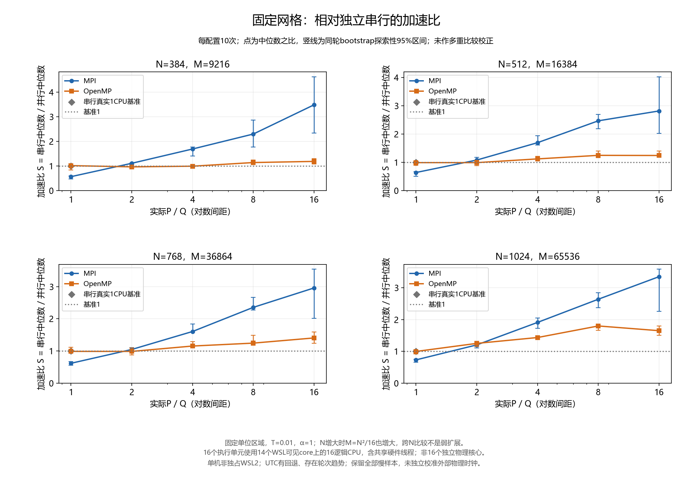
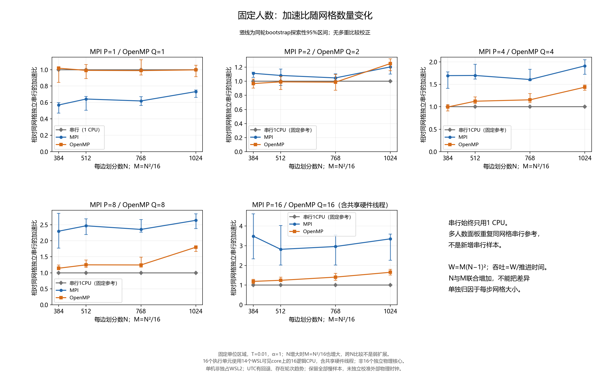

# 二维热传导方程的串行、MPI与OpenMP求解

《并行与分布式计算》2026年秋季学期期末大作业 · 第4题
姓名：待填写　学号：待填写　日期：2026-11-12

## 摘要

本项目在单位正方形上求解二维常系数热方程，使用时间向前Euler、空间中心差分的五点显式格式，以双缓冲保存相邻时间层，分别实现独立串行、MPI与OpenMP程序。MPI按内部行连续分块并交换旧层halo；OpenMP用持续团队循环分配整行，通过屏障与单线程交换保证时间层一致。正确性同时核对连续解析解、离散正弦模态和独立串行全场，并检验联合加密趋势与并行边界情况。

性能沿用已验收M4证据：原实验23配置/115正式样本；隔离诊断01为215预热/2560正式调用；扩大02-r1为44预热/440正式样本。正式性能始终使用原三个程序。最大网格N=1024、M=65536时，独立串行推进中位数35.3892秒，MPI16为10.5662秒、加速比3.3493，OpenMP8为19.6692秒、加速比1.7992；OpenMP16为21.4382秒。收益并非随网格或执行单元数普遍单调增加。结果受非独占WSL、硬件线程共享、轮次趋势及未校准外部物理时间等限制，不能据此确定唯一硬件瓶颈。本报告整理已有真实输出，没有新增性能采样或修改求解器。[R1–R5]

## 1. 任务要求与项目范围

教师任务书第1页要求独立串行与一种自行选择的并行程序、正确性验证、重复计时、固定规模和扩大工作量分析、书面报告与5分钟PPT，并披露AI使用及核查实例。第3页给出本题模型、稳定性、双缓冲和MPI旧层边界行要求。本项目由用户确认增加独立MPI与OpenMP两种比较对象，采用C++17、CMake/CTest；混合并行、隐式法和正式优化不在本次范围。[R1,R2]

用户独立负责范围选择、项目管理、审核验收与答辩，Codex在授权范围内完成实现、测试、实验记录和材料整理。M4验收交付为Evaluation@30c4a43；M5材料仍待用户审核。不能把用户阶段验收扩写成未记录的逐行代码审查或人工复现实验。个人信息尚待本人填写。[R6]

## 2. 数学模型、离散与稳定性

在区域 $\Omega=(0,1)^2$，热扩散率 $\alpha>0$，终点 $T>0$：

$$
u_t=\alpha(u_{xx}+u_{yy}),\qquad u|_{\partial\Omega}=0,\qquad
u(x,y,0)=\sin(\pi x)\sin(\pi y).
$$

连续解析解为

$$
u(x,y,t)=e^{-2\alpha\pi^2t}\sin(\pi x)\sin(\pi y).
$$

每方向分为N个区间，节点数为N+1，总节点数 $(N+1)^2$；内部节点 $(N-1)^2$。令 $h=1/N$，$\Delta t=T/M$，$r=\alpha\Delta t/h^2$。由向前Euler与两个方向的中心差分得到

$$
U_{ij}^{n+1}=(1-4r)U_{ij}^{n}+r(U_{i-1,j}^{n}+U_{i+1,j}^{n}+U_{i,j-1}^{n}+U_{i,j+1}^{n}).
$$

时间截断误差一阶、空间二阶，总体一致性为 $O(\Delta t+h^2)$。这里i为行/x方向，j为列/y方向。程序恰推进M次，最终比较时刻均为T，不用浮点时间累加决定退出。[R2,R7]

对傅里叶误差模态，放大因子为

$$
G=1-4r[\sin^2(\theta_x/2)+\sin^2(\theta_y/2)].
$$

要求 $|G|\le1$，取 $0<r\le1/4$ 可满足二维显式稳定条件；此时五点权重非负且和为1，也支持离散最大值原理。不能沿用课程一维算例的1/2上限。稳定不等同任意时间步都足够精确。代码用long double中间值严格比较r与0.25，不加epsilon接受超限输入；同时检查N≥2、M≥1、有限正T/alpha及数组规模可表示性。可表示不保证实际内存足够。[R2,R7]

右端五个值必须全部来自旧层。两个连续double数组old/next分开读写；一层完成后交换角色，奇偶步均返回实际最终层。全场行主序索引为 `i*(N+1)+j`。每份全场内存约 $8(N+1)^2$ 字节，双缓冲约16倍节点数；累计内点更新量定义为 $W=M(N-1)^2$，它是更新次数，不是FLOP计数。[R7]

## 3. 三种独立实现

### 3.1 独立串行基线

`heat_serial`单独构建，不链接MPI或OpenMP。`heat.cpp`提供参数验证、初值、step及solve；每步先检查数组大小/别名并置新层四边为零，再按行更新内点并swap。解析公式仅用于初始化的空间正弦分布及推进后的验证，不用解析终值代替数值演化。[R7]

共享参数/输出辅助代码并不取消独立串行基线：它通过自身串行推进路径产生全场及Ts。不能将MPI P=1或OpenMP Q=1耗时替代Ts；它们仍包含各自实现、运行时和数据布局成本。相同算法、输入与编译优化也不保证机器码或单执行单元速度一致。[R3,R7]

三程序共用命名参数 `--N --M --T --alpha`，默认20/400/0.1/1；默认输出全场CSV，stderr报告解析误差和loop_seconds。`--summary-only`省略全场CSV，仍推进、验证，MPI仍收集。OpenMP另接受 `--threads Q`，默认1；MPI请求P来自启动命令，实际P由通信器大小记录。[R2,R7]

### 3.2 MPI连续行分块与halo

设K=N−1，进程数P，rank编号p。令 $q=\lfloor K/P\rfloor$，$s=K\bmod P$，则

$$
m_p=q+[p<s],\qquad o_p=pq+\min(p,s).
$$

rank p拥有全局行 $o_p+1$ 至 $o_p+m_p$，每行N+1列；局部行k映射全局行o_p+k。本地old/next各有 $(m_p+2)(N+1)$ 个元素，上下各一行halo。例N=8/P=3，内部7行分成3/2/2，分别拥有1–3、4–5、6–7，避免把子域当作独立单位区域初始化。[R8]

每步先将端部物理halo清零，以MPI_PROC_NULL表示缺失邻居。第一次Sendrecv向上发送首拥有行、从下接收底halo（标签71）；第二次向下发送末拥有行、从上接收顶halo（标签72）。完整旧层行连续传输，随后更新本区内点、置左右边界并交换。Sendrecv组织配对发送接收，避免所有rank先阻塞发送导致的典型死锁。PROC_NULL接收不负责清零缓冲，物理边界必须自行维护。每步没有额外全局Barrier；邻居数据依赖通过通信完成。[R8]

本实现规定 $1\le P\le N-1$，保证每rank至少一行，这是实现选择而非MPI普遍限制。经典int计数/位移范围也提前验证。分配状态用Allreduce协调；输入/输出路径保持rank一致退出，通信错误走MPI_Abort。该保证不覆盖真实rank丢失、强制终止或OOM killer。推进后归约解析误差并Gatherv重建全场，root核对收集场与归约误差。[R8,R9]

### 3.3 OpenMP行划分、数据属性与同步

`heat_openmp`不链接MPI，在进入并行区前分配两份完整全场并初始化零边界。一个持续存在的 `parallel default(none)` 团队完成全部M步。old/next与实际团队数共享，N/M/行宽/r为firstprivate只读副本；循环变量n、i及块内j/k为线程私有。每个next内点只被一个线程写入，旧层只读。[R10]

正式实现采用 `omp for schedule(static,1)`，按整行循环分配。实际团队大小A时，行i归线程 `(i-1)%A`，线程t拥有1+t、1+t+A等行。例如N=7/A=4，行集合分别为{1,5}、{2,6}、{3}、{4}。这与MPI连续分块不同，也没有将诊断中的连续行优化合入正式程序。[R10]

每步for末隐式屏障先完成整层写入，再由single线程执行共享vector交换，single末隐式屏障发布交换，所有线程方可进入下一步；两处都没有nowait。只删single屏障会使线程看到不同缓冲角色，不能安全简化。两份数组物理边界初始为零且以后不写，始终保持零。[R10]

入口关闭动态调整并显式请求Q，实际A在推进团队内由omp_get_num_threads读取。运行时限制可能使A<Q，请求与实际须分别记录。Q>N−1合法，部分线程无行但仍参与同步；不能套用MPI的P限制。运行时线程创建失败可能自行非零退出，不声称C++异常处理能捕获所有运行时错误。[R10]

## 4. 正确性验证与证据

连续解析误差 $E_\infty=\max|U^M-u(T)|$ 检查数值算法对连续问题的精度；串并行差 $D_\infty=\max|U^M_{parallel}-U^M_{serial}|$ 检查分解与同步的一致性。另独立用离散正弦模态 $U^0g^M$，其中 $g=1-8r\sin^2(\pi/(2N))$，检查实际终层。并行一致不能替代解析误差，解析解/离散模态也只在验证端使用。[R2,R9]

历史M3的Debug/Release各19/19通过；M4增加计时回归后各20/20，隔离诊断启用时各21/21。扩大实验另有8/16资源与字段/统计/超时检查。不同阶段测试数不同，不能把其中一个数字当成所有目录均重跑的结论。本次M5只校验归档证据与材料，不新增求解器回归通过记录。[R4,R9]

M3固定T/alpha/r，N加倍、M四倍，三组r=0.05/0.1/0.25均检验。默认组T=0.1、alpha=1、r=0.1的真实数据如下；Debug/Release和同输入各实现的误差一致，表取Debug独立串行行。[R9]

| N | M | E_inf | 前层/本层误差比 | 观测阶 |
| ---: | ---: | ---: | ---: | ---: |
| 20 | 400 | 1.126210917414272e-4 | — | — |
| 40 | 1600 | 2.818135112095388e-5 | 3.996299 | 1.998664 |
| 80 | 6400 | 7.046962600038009e-6 | 3.999078 | 1.999667 |

这是dt∝h²下的联合二阶趋势，不是时间二阶。所选矩阵避开r≈1/12的主误差抵消；误差比采用约3.8–4.2的回归区间，解析误差上界由所选模态渐近式留余量，不作为任意输入定理。[R2,R9]

覆盖还包括非对称手算、旧层不变、初值/零边界、奇偶步、MPI不均匀分块/每rank一行/超限P、OpenMP线程多于行/请求4实际2、r=1/4及相邻浮点超限、非法输入和输出失败、受控分配/通信故障与超时。小规模D_inf容差1e-13，正式大规模验证为1e-12，不能因观测零差而宣称任意规模逐位一致。[R9]

02-r1完整场预热观测最大D_inf=0，离散模态最大差6.638023464233811e-13，连续E_inf约1.1693e-7至8.3148e-7。正式计时样本不存储大场作性能数据，保留验证摘要与输出哈希。[R4,R5]

## 5. 性能实验方法

### 5.1 环境、编译与计时边界

归档环境为单机WSL2、Intel i7-14700HX，来宾可见28逻辑CPU/14 core、约7.6 GiB内存；GNU C++13.3.0、Open MPI4.1.6、GNU OpenMP4.5/libgomp（归档包14.2）。Release统一C++17、-O3 -DNDEBUG，无fast-math、march=native或LTO，仅OpenMP链接-fopenmp。环境非独占，虚拟拓扑不证明宿主P/E核映射或物理核独占。[R3–R5]

原矩阵绑定CPU0/2/4/6；02-r1扩至0,2,…,26,1,3所组成的集合，MPI/OpenMP同人数使用同集合。16执行单元为14个WSL可见core上的16逻辑CPU，含兄弟硬件线程，不能称16独立物理核心。MPI保存rank绑定报告，OpenMP记录实际团队及运行时诊断/任务亲和性快照；快照不等于连续监控。[R3,R5]

| 程序 | 计时范围内 | 计时范围外 |
| --- | --- | --- |
| 串行 | M次step：缓冲/参数检查、边界清零、内点更新、swap | 参数解析、分配、初值、解析验证与输出 |
| MPI | 每rank M步：物理halo清零、两次Sendrecv及等待、更新/交换；取各rank本地耗时最大值 | MPI生命周期、参数广播、开始前Barrier、计时/误差归约、Gatherv、验证和输出 |
| OpenMP | 一次团队进入/退出、实际团队查询、M步更新、for屏障、single交换及屏障 | 参数解析、分配、初值、验证和输出 |

串行steady_clock、MPI_Wtime和omp_get_wtime均按起止差读取；MPI不跨rank相减绝对时间。MPI最大值归约操作本身在范围外，但各rank测得推进耗时的最大值为样本。OpenMP进入/退出不意味着每次都新建/销毁操作系统线程。loop_seconds不是端到端耗时，也不是纯算术成本；CTest测试用时不能代替它。[R3,R7,R8,R10]

### 5.2 三批统计对象与样本保护

| 批次 | 冻结代码 | 预热/正式 | 统计对象 |
| --- | --- | --- | --- |
| 原M4 | 75cdaad | 23/115；23配置各5正式 | median(Ts)/median(Tp)，时间min/max |
| 隔离诊断01 | 1e2fb5f | 215/2560；共2775调用 | 对照主要为10对耗时比率的中位数、配对bootstrap；含原路径复测等不同组 |
| 完成02-r1 | 646f7c4 | 44/440；44配置各10正式 | 同网格median(Ts)/median(Tp)，同轮共同bootstrap |
| 停止02 | e715560 | 预热阶段停止；0正式 | 不进入完成数据统计 |

固定种子交错运行、预热全场验证，采样顺序执行，不与本项目构建/检查重叠；宿主其他活动无法排除。全部慢样本保留，无为美化结果的剔除。02因单rank绑定报告歧义停止，修正报告兼容后以新编号02-r1重新冻结采样，失败证据保留。[R3–R5]

正式加速比 $S=\mathrm{median}(T_s)/\mathrm{median}(T_p)$，效率 $E=S/p$，MPI取实际P、OpenMP取实际Q；E不是CPU利用率。诊断的配对比率中位数不可混作正式S。时间min/max是样本范围，不是置信区间；02-r1以同轮串/并行共同重采样10000次给探索性95%区间，诊断则重采样配对比率。均未作多重比较校正，区间不能自动消除时变因素或证明唯一因果。[R3–R5]

## 6. 实测结果与解释

### 6.1 原M4与扩大工作量

原固定N/M=128/1024时MPI4的S=1.2820、OpenMP4的S=0.6811；N/M=384/9216时分别为1.5214和0.9758。这些是原批次五样本中位数之比，不应与02-r1相同网格的新十样本合并。OpenMP4比2快，不等于它快于独立串行。[R4]

原扩大工作量随目标p=1/2/4采用N/M=256/4096、304/5776、362/8191，保持单位物理域、T=0.01、alpha=1，W/W1=1、1.991004、4.007846；W/p相对基础偏差约−0.4498%与+0.1961%。每rank/线程实际最小最大更新量也保留在summary.csv。[R3,R4]

定义相对各实现基础网格自身p=1的吞吐增长 $R=(W/W_1)T_{p1}/T_p$。到目标p=4，MPI R=2.2053、R/p=55.13%；OpenMP R=0.8037、R/p=20.09%。相同大网格独立串行基线对应的S分别为1.3387与0.8795；两类指标基线不同，不能混为效率。随规模增加，串行吞吐本身也变化，必须实测同网格Ts。[R4]

### 6.2 02-r1四组强扩展

N=384/512/768/1024，M=N²/16=9216/16384/36864/65536，固定T=0.01、alpha=1、r=0.16。每个固定N/M组分别属于强扩展。下表精确值来自归档统计，舍入展示，不用已舍入数反算S。[R5]

| N | MPI16 S | MPI16 E | OpenMP8 S | OpenMP16 S |
| ---: | ---: | ---: | ---: | ---: |
| 384 | 3.4885 | 21.80% | 1.1433 | 1.1894 |
| 512 | 2.8183 | 17.61% | 1.2491 | 1.2441 |
| 768 | 2.9596 | 18.50% | 1.2453 | 1.4063 |
| 1024 | 3.3493 | 20.93% | 1.7992 | 1.6508 |



图1：点为中位数之比，竖线为同轮bootstrap探索性95%区间。4面板各固定N/M；16执行单元包含14个WSL可见core上的兄弟线程。[R5]

N=1024时独立串行35.389156603秒；MPI P=1为48.315583805秒，P=16为10.566213652秒；OpenMP Q=8为19.669246715秒，Q=16为21.438211412秒，效率分别22.49%和10.32%。因此扩大总时间到数十秒仍不能消除全部实现差距，“任务太小”不足以解释全部现象。MPI在四网格内随P增加中位耗时均下降，但MPI16随N的S并不单调；OpenMP16也不保证优于8。8/16直接比率未另建区间，不宣称所有运行都稳定优胜。[R5]



图2：每个点使用各自同网格独立串行基线。跨N同时增加M，W约随N⁴增长；这是联合加密/扩大工作量，不能称弱扩展，也不能把全部变化单独归因于每步粒度。[R5]

### 6.3 Amdahl与Gustafson的适用边界

Amdahl模型 $S(p)=1/[f+(1-f)/p]$ 针对固定工作量和常数串行比例。可用 $f_{eff}=(p/S-1)/(p-1)$ 作诊断，但原M4同规模不同p得到的值不恒定，OpenMP还出现大于1的值；实现差异、通信同步和环境效应使它不能当作源码真实串行比例，更不能外推无限核心极限。[R4]

Gustafson模型 $S_G=p-\sigma(p-1)$ 强调扩大可并行工作且相近并行时间下的扩展潜力。原实验W≈pW1，但推进时间未保持恒定，且未单独测sigma；因此只结合吞吐讨论其前提局限，不拟合虚构sigma或宣称实证线性加速。二维固定T/r有M∝N²、W∝N⁴，因此W≈p要求N≈p^(1/4)，不是简单N²∝p。02-r1跨网格也不是新增的理想弱扩展实证。[R3,R4]

### 6.4 隔离诊断：支持的因素与未确定机制

诊断01将原路径baseline、隔离副本replica、未插桩变体和插桩路径分开；baseline/replica与插桩前后两层校准，扰动超过5%时限制分项解释。10对比率中位数变化至少5%、至少8/10对方向一致且区间不跨1，仅作为探索性可重复影响判据。[R4]

未插桩对照支持MPI计算执行/编译上下文与OpenMP行划分的影响：核心MPI1公共行内核对照A/B约1.583；N384/Q4连续行划分约2.763。这里A/B是replica/变体，绝不是正式程序优化后的S。空邻居通信未满足影响判据；循环行划分下单改同步未产生同等收益；PASSIVE等待变慢；所选8个单CPU对照未满足判据，CPU分组按冻结触发条件未运行。[R4]

这些证据支持特定实施因素，不足以确证缓存带宽、伪共享、单条栈写入、宿主频率或调度是唯一根因。没有直接硬件事件，不能把局部性推理写成缓存实测；通信分项包含等待，多个worker分项最大值不可相加成总耗时。诊断变体没有进入正式求解器，也没有自动授权优化。[R4,R6]

### 6.5 波动与时钟限制

02-r1有34/44配置的前3轮/末3轮中位数>1.1，保留全部样本；这说明存在轮次趋势，不能宣称完全平稳。UTC有11处相邻调用起点回退，146次UTC/单调区间差绝对值>1秒；UTC结束还包括输出哈希后处理，146不是精确校时次数。原M4也有UTC不一致且未保存逐次单调起点时间线，顺序执行由脚本阻塞结构支持，不声称UTC独立证明无重叠。[R4,R5]

本机正常求解器时钟路径与父进程使用CLOCK_MONOTONIC，02-r1单调调用区间无重叠、loop_seconds被外层区间包含。但未独立校准外部物理时间，不能据此完全排除虚拟机计时影响或推断NTP/宿主具体机制。绑定不等于资源独占，16组还改变兄弟线程共享。结果严格限于归档WSL环境、实现与计时定义。[R4,R5]

## 7. AI使用、核查与实际贡献

Codex辅助规范恢复、算法与接口设计、C++实现、测试脚本、诊断设计、真实实验组织、统计绘图及本报告/PPT草稿。用户确认技术范围和接口、选择补充实验、审核阶段成果并负责最终材料和现场答辩；不声称用户独立手写了AI生成代码，也不虚构人工复测。[R6]

核查实例一：AI最初把MPI启动器stdout重定向到/dev/full当作rank输出失败测试，4项失败被保留；改为rank内重定向后回归通过，见m2-initial.log/m2.log。实例二：扩大运行02因MPI单rank绑定报告歧义停止，保留0正式样本，探针确认实际CPU0后修正报告候选列表、补齐全部P测试并重新冻结为02-r1。实例三：诊断发现有收益的变体仍保持隔离，正式图表只使用原程序，避免将不同路径性能混写。[R4,R6,R9]

这些属于AI执行的核查/修正与用户授权记录。M4已由用户验收，不能替代M5报告/PPT人工审阅；姓名学号、口头掌握程度和真实5分钟演练仍待本人核实。材料中的讲稿时长预算/字数检查不冒充人工实讲。[R6]

## 8. 结论与复现

三种实现遵守相同模型和五点格式，通过解析/离散模态/串行全场及联合加密验证。MPI分块通信和OpenMP共享同步各有明确正确性契约；性能需要独立串行基线、实际资源与可比计时范围。现有数据展示有限加速、规模与人数的非单调效应及具体实施因素影响，同时保留WSL/时钟/趋势限制。没有加速或未确定唯一机制也是有效结论，不据此删样本或增加未授权采样。

下列构建/数值命令供复现，本次M5未重新执行；迁移机器先核对资源与环境，历史完整命令见原日志。

```bash
cmake -S . -B build/reproduce -DCMAKE_BUILD_TYPE=Release
cmake --build build/reproduce --target check --parallel 2
./build/reproduce/heat_serial --N 20 --M 400 --T 0.1 --alpha 1
mpiexec -n 4 ./build/reproduce/heat_mpi --N 20 --M 400 --T 0.1 --alpha 1
./build/reproduce/heat_openmp --threads 4 --N 20 --M 400 --T 0.1 --alpha 1
# 仅校验现有工件与重算统计，不运行求解器或采样：
python3 scripts/check_results.py
```

## 引用与证据入口

- R1：本地教师任务书 `docs/sources/final.pdf` 第1、3页，本轮提取文字并查看原页；课程资料不随Git分发。方法参考MPI第9/10/11讲与OpenMP第3/5/6讲，仅本地只读。
- R2：[SPEC](../SPEC.md)、[DESIGN](../docs/DESIGN.md)：数学合同、实现与判据。
- R3：[原性能协议](../results/performance/baseline/README.md)、[原环境](../results/performance/baseline/run-01/environment.log)。
- R4：[统一结果](../results/RESULTS.md)：原M4、诊断01、扩大02-r1、停止02、时钟审计及原始工件链接。
- R5：[02-r1统计CSV](../results/performance/large-02-r1/m4-diagnostic-02-r1.csv)、[元数据](../results/performance/large-02-r1/m4-diagnostic-02-r1.json)、[新版图清单](../results/figures/large-02-r1-viz-01/generation.json)。
- R6：[AI_USAGE](../docs/AI_USAGE.md)、[DECISIONS](../docs/DECISIONS.md)、[STATUS](../STATUS.md)：授权、取舍及人工状态。
- R7：[heat.cpp](../src/heat.cpp)、[CMakeLists.txt](../CMakeLists.txt)：独立串行与构建。
- R8：[heat_mpi.cpp](../src/heat_mpi.cpp)、[main_mpi.cpp](../src/main_mpi.cpp)：分块、通信、计时、错误协调。
- R9：[M3原始日志](../results/validation/m3.log)、[M3误差CSV](../results/validation/m3-errors.csv)、[系统测试](../tests/check_system.py)、[MPI首轮失败](../results/validation/m2-initial.log)、[修正后日志](../results/validation/m2.log)。
- R10：[heat_openmp.cpp](../src/heat_openmp.cpp)、[OpenMP测试](../tests/check_openmp.py)：行归属与同步。
