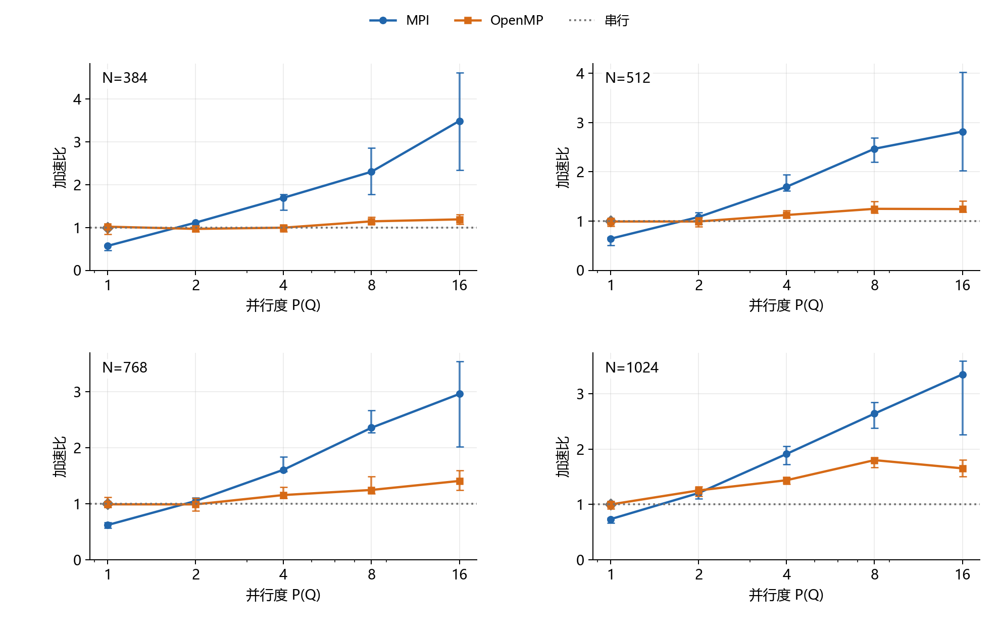

# 二维热传导方程的串行与并行数值求解

《并行与分布式计算》2026年秋季学期期末大作业 · 第4题
姓名：王君豪　学号：2024110902025　

## 摘要

针对二维热传导方程数值求解中的并行计算效率问题，本文采用五点显式有限差分格式与双数组时间推进方法，基于 C++17 分别实现独立串行、MPI 多进程和 OpenMP 多线程三种求解程序。其中，MPI 采用连续行分块与相邻进程数据交换，OpenMP 采用共享内存下的行任务划分与线程同步，实现相同数学模型的并行计算。

通过解析解误差、串并行结果一致性、网格加密收敛阶及自动化测试验证程序正确性，并设计固定规模强扩展、不同网格规模、扩大工作量及实现因素对照实验，评价并行性能。

实验结果表明，联合加密空间网格和时间步长时，数值解的观测收敛阶接近 2。在 (N=1024)、(M=65536) 的测试规模下，MPI 使用 16 个进程获得 3.3493 倍加速，OpenMP 使用 8 个线程获得 1.7992 倍加速；OpenMP 增加至 16 个线程后，中位耗时反而上升。补充诊断表明，计算内核的实现方式和线程任务划分策略均会显著影响运行性能。

研究结果说明，并行计算能够缩短热传导数值求解的运行时间，但实际加速效果受任务规模、通信与同步开销及程序实现方式等因素共同影响。

## 1. 问题描述与程序功能

### 1.1 研究问题与求解目标

设想一块中心较热、四边始终保持零温度的薄板。热量随时间扩散，内部温度逐渐降低。本项目要回答的是：给定初始分布和终止时刻 $T$，各位置的温度是多少？题设的初始分布、区域和边界条件固定，使用者通过参数控制计算精细程度、观察时刻和热扩散率。


| 求解方式     | 提供的功能                                       | 计算如何分工                                           |
| ------------ | ------------------------------------------------ | ------------------------------------------------------ |
| 独立串行     | 输出完整温度场、误差和推进耗时，提供比较基准     | 一个执行流程逐行完成全部计算                           |
| MPI多进程    | 在相同输入下并行计算，最后由主进程输出完整温度场 | 每个进程保存并更新一段连续行，每步向邻进程交换所需温度 |
| OpenMP多线程 | 在相同输入下并行计算，并报告请求与实际线程数     | 多个线程共享温度数组，按行分工，每步完成后同步换层     |

三种方式采用相同的五点显式差分算法、初边值和精度要求。并行功能增加后，输出仍表示同一时刻、同一网格上的温度；是否更快需要通过实际计时判断。下文先说明输入输出与算法，再解释分工、验证和性能。

### 1.2 输入参数与运行约束


| 输入                  | 含义                                     | 默认值与要求                              |
| --------------------- | ---------------------------------------- | ----------------------------------------- |
| `--N`                 | 每个空间方向等分的区间数；越大则网格越细 | 20；整数$N\geq2$，每方向有 $N+1$ 个节点   |
| `--M`                 | 从$0$ 推进到 $T$ 所用的时间步数          | 400；整数$M\geq1$，须满足第2节稳定性条件  |
| `--T`                 | 希望计算到的终止时刻                     | 0.1；有限正数                             |
| `--alpha`             | 热扩散率，表示温度扩散快慢               | 1；有限正数                               |
| MPI启动进程数$P$      | 参与计算的进程数量                       | 由启动命令指定；本实现要求$1\le P\le N-1$ |
| OpenMP的`--threads Q` | 请求参与计算的线程数量                   | 默认1；正整数，实际线程数可能受运行时限制 |

### 1.3 结果输出与评价指标

正常运行时，标准输出给出终止时刻 $T$ 的全场CSV，可保存为文件后逐点比较；标准错误输出给出参数、解析误差和推进耗时等摘要。CSV包含以下七列。


| 字段        | 读者可以据此了解什么                         |
| ----------- | -------------------------------------------- |
| `i,j`       | 网格点的行、列编号                           |
| `x,y`       | 该点在单位薄板上的坐标                       |
| `u_numeric` | 从初值逐步计算得到的温度                     |
| `u_exact`   | 同一点、同一终止时刻的解析温度，作为检验参考 |
| `abs_error` | 该点数值温度与解析温度之差的绝对值           |

### 1.4 项目实现范围

本项目采用C++17实现独立串行、MPI与OpenMP三种求解程序，使用CMake构建和CTest测试。三种方式均采用题设的五点显式格式与双数组推进，比较相同问题下的结果和运行速度。研究范围限于单机上的这三种实现，不包含MPI与OpenMP混合并行、隐式算法或将诊断变体替换为正式求解器。

## 2. 数学模型与数值离散方法

### 2.1 热传导模型与网格离散

用 $u(x,y,t)$ 表示位置 $(x,y)$ 在时刻 $t$ 的温度。题设区域记为 $\Omega=(0,1)^2$，即单位正方形；四边恒温为零，初始温度为正弦分布：

$$
u_t=\alpha(u_{xx}+u_{yy}),\qquad (x,y)\in(0,1)^2,\qquad 0<t\le T,
$$

$$
u|_{\partial\Omega}=0,\qquad u(x,y,0)=\sin(\pi x)\sin(\pi y).
$$

方程表示温度随周围温度的空间变化而扩散。该题还给出了可直接计算的连续解析解，便于检验程序是否逼近正确的物理问题：

$$
u(x,y,t)=e^{-2\alpha\pi^2t}\sin(\pi x)\sin(\pi y).
$$

计算机用有限个节点近似连续薄板。在 $x$、$y$ 两个方向各等分 $N$ 个区间，网格间距 $h=1/N$；令 $x_i=ih,y_j=jh$，其中 $0\le i,j\le N$。总节点数为 $(N+1)^2$，去掉四边后需要更新的内部节点数为 $(N-1)^2$。本实现将 $i$ 作为行/$x$ 方向、$j$ 作为列/$y$ 方向。时间也均分为 $M$ 步，步长 $\Delta t=T/M$，时间层 $t_n=n\Delta t$。默认 $N=20$ 时 $h=0.05$，$M=400$、$T=0.1$ 时 $\Delta t=0.00025$，程序恰好推进400次到 $T$。

### 2.2 五点显式差分格式

记 $U_{ij}^n$ 为第 $n$ 个时间层、节点 $(i,j)$ 的数值温度。时间导数用当前层到下一层的差商近似，两个空间二阶导数分别用左右、上下邻点的中心差分近似：

$$
\frac{U_{ij}^{n+1}-U_{ij}^{n}}{\Delta t}
=\alpha(\frac{U_{i-1,j}^{n}-2U_{ij}^{n}+U_{i+1,j}^{n}}{h^2}
+\frac{U_{i,j-1}^{n}-2U_{ij}^{n}+U_{i,j+1}^{n}}{h^2}).
$$

整理后得到五点显式格式：

$$
U_{ij}^{n+1}=(1-4r)U_{ij}^{n}+r(U_{i-1,j}^{n}+U_{i+1,j}^{n}+U_{i,j-1}^{n}+U_{i,j+1}^{n}),
\qquad r=\frac{\alpha\Delta t}{h^2}.
$$

计算依赖如下表所示，四个对角点不参与这一次更新。


| 读取的旧层位置               | 在新温度中的权重      |
| ---------------------------- | --------------------- |
| 中心$(i,j)$                  | $1-4r$                |
| 上下两点$(i-1,j)$、$(i+1,j)$ | 每点$r$               |
| 左右两点$(i,j-1)$、$(i,j+1)$ | 每点$r$               |
| 写入位置                     | 新层的同一节点$(i,j)$ |

各内点按相同规则计算，边界保持为零。该格式时间一阶、空间二阶，总体一致性为 $O(\Delta t+h^2)$。

### 2.3 双数组时间推进方法

同一步所有节点必须读同一个旧时间层。用两份数组分别保存“已知旧层”和“待写新层”，实现中的名称为`old`与`next`。

完整求解顺序为：

1. 检查参数及稳定性，分配两份温度数组；按正弦初值设置旧层，四边取零。
2. 保持旧层只读，用五点公式逐点填写新层的全部内部节点，新层四边仍取零。
3. 等整层完成后交换两数组的角色，让刚完成的新层成为下一步的旧层；交换角色不需要逐点复制全场。
4. 重复第2、3步，累计恰好 $M$ 次，得到 $T$ 时刻温度；最后计算误差并输出。

奇数步、偶数步结束后均输出实际最终层。串行与OpenMP各保存两份完整温度场；MPI保存局部行与邻接行副本，详见第3节。每份完整`double`数组约占 $8(N+1)^2$ 字节，双数组约占 $16(N+1)^2$ 字节。累计内部节点更新量定义为 $W=M(N-1)^2$，单位是更新次数，用于比较工作量。

### 2.4 数值稳定性条件

显式算法的时间步长不能任意大。本题要求

$$
0<r=\frac{\alpha\Delta t}{h^2}\le\frac{1}{4},
\qquad \Delta t\le\frac{h^2}{4\alpha}.
$$

在这一条件下，五个温度的权重均非负、和为1，新值是旧值的加权平均，支持离散最大值原理。固定 $T$ 和 $\alpha$ 时，网格间距减半，允许的最大时间步长缩为原来的四分之一；若保持 $r$ 不变，就要将 $M$ 增加为四倍。这也是后续扩大网格时计算量增长很快的原因。

进一步作傅里叶稳定性分析：设误差由空间振荡模式组成，$\theta_x$、$\theta_y$ 为两个方向相邻节点之间的相位差，每推进一步的放大因子为

$$
G=1-4r[\sin^2(\theta_x/2)+\sin^2(\theta_y/2)].
$$

要求各模式 $|G|\le1$，可得到上述二维稳定上限 $1/4$。

## 3. 串行与并行算法实现

### 3.1 串行求解器与性能基准

串行方式由一个执行流程完成第2节的全部步骤。每步检查两数组的大小和是否意外使用了同一个数组，将新层四边清零，再按行计算所有内点，整层结束后交换数组角色。它输出的完整温度场用于核对并行结果，推进耗时记作 $T_s$。

伪代码：

```text
读取并检查 N、M、T、alpha，计算 h、dt、r
分配 old、next：old 按正弦初值初始化，next 清零
开始计时
对 n = 0, 1, …, M-1：
    检查两数组大小、不是同一数组及 r
    将 next 的四条边清零
    对内部行 i = 1, 2, …, N-1：
        对内部列 j = 1, 2, …, N-1：
            next[i,j] ← 五点更新(old, i, j, r)
    交换 old 与 next 的角色
结束计时，得到 Ts
用 old 计算解析误差，输出最终温度场与摘要
```

即使MPI仅用一个进程、OpenMP仅用一个线程，仍会带有各自的数据布局和运行时成本，因此它们的耗时不能替代 $T_s$。后面所有正式加速比都使用相同输入的独立串行时间作为基线。

### 3.2 MPI 行分块与邻接通信

MPI按行分工。每个进程计算自己负责的行（拥有行），并在上下各留一行halo，存放邻进程的旧层数据。每步先交换这些数据，再更新本进程负责的内点。

一般地，设 $K=N-1$ 个内部行、$P$ 个进程，进程编号（rank）为 $p$，从 $0$ 开始。令 $q=\lfloor K/P\rfloor$，$s=K\bmod P$，先每进程分 $q$ 行，再给前 $s$ 个进程各加一行：

$$
m_p=q+[p<s],\qquad o_p=pq+\min(p,s).
$$

其中 $[p<s]$ 在条件成立时为1，否则为0；$m_p$ 为拥有行数，$o_p$ 为前面进程拥有的总行数。进程 $p$ 拥有全局行 $o_p+1$ 至 $o_p+m_p$，局部行 $k$ 对应全局行 $o_p+k$。本地每份新旧数组大小为 $(m_p+2)(N+1)$；初始化使用全局坐标。

MPI的完整流程如下，各进程只更新自己的拥有行，halo不作为本进程的计算结果输出。

```text
各进程检查参数与 P，计算 h、dt、r，确定拥有行数、全局偏移和上下邻居
分配局部 old、next；主进程另备全场；共同确认分配成功
按全局坐标初始化 old，next 清零
所有进程同步一次，然后各自开始计时
对 n = 0, 1, …, M-1：
    若没有上邻居，将 old 顶部 halo 置零
    若没有下邻居，将 old 底部 halo 置零
    发送首个拥有行给上邻居，同时从下邻居接收底部 halo
    发送末个拥有行给下邻居，同时从上邻居接收顶部 halo
    对本进程拥有行 k = 1, 2, …, m_p：
        将 next 第 k 行的左右边界置零
        对内部列 j = 1, 2, …, N-1：
            next[k,j] ← 五点更新(old, k, j, r)
    交换本地 old 与 next 的角色
各自结束计时；归约取最大耗时，作为 Tp
各自计算拥有行的解析误差，归约取最大值
仅收集 old 中的拥有行到主进程，按全局顺序重建温度场
主进程核对全场误差与归约误差，再输出温度场与摘要
```

代码用两次`MPI_Sendrecv`配对发送与接收，避免所有进程先作阻塞发送造成的典型死锁。以`MPI_PROC_NULL`表示没有邻居的端部，同时维护物理边界。

本实现要求 $1\le P\le N-1$，让每个进程至少拥有一行，并且提前检查MPI传统`int`计数与位移范围。推进结束后，由`MPI_Gatherv`将各段结果收集到主进程，重建完整场，并核对收集场的解析误差与各进程归约误差一致。分配状态通过`MPI_Allreduce`协调，输入和输出错误沿一致路径退出，通信错误调用`MPI_Abort`。

### 3.3 OpenMP 行划分与线程同步

OpenMP让多个线程在同一进程中共享两份完整温度场，因此不需要复制邻居行。每步各线程只写自己负责的新层内点，并共同读取旧层；只要每个内点由一个线程写入，就可以并行完成同一时间层的更新。

任务按循环方式分配：设实际团队大小为 $A$，线程编号 $t$ 从 $0$ 开始，线程 $t$ 负责 $1+t$、$1+t+A$ 等内部行，对应实现是`omp for schedule(static,1)`。

交换新旧数组前后都要同步，保证整层写完才换层，换层完成才进入下一步。

```text
检查参数与请求线程数 Q，计算 h、dt、r，分配共享的 old、next
old 按正弦初值初始化，next 清零；两数组的四边始终为零
关闭动态线程调整，开始计时
创建一个持续的线程团队，请求 Q 个线程：
    一个线程记录实际团队大小 A，所有线程同步
    每个线程 t 执行相同的时间循环 n = 0, 1, …, M-1：
        对本线程的内部行 i = 1+t, 1+t+A, …，且 i < N：
            对内部列 j = 1, 2, …, N-1：
                next[i,j] ← 五点更新(old, i, j, r)
        所有线程同步，确认整层计算完成
        仅一个线程交换共享 old 与 next 的角色
        所有线程同步，确认换层完成
退出线程团队，结束计时，得到 Tp
用 old 计算解析误差，输出温度场、实际线程数与摘要
```

伪代码的行分配对应`omp for schedule(static,1)`；其循环末尾隐式屏障保证整层计算完成，交换由`single`执行，其末尾隐式屏障保证换层完成。即使某个线程没有分到内部行，也参加这两次同步。

全部 $M$ 步由一个持续的线程团队完成，两份数组和实际团队数共享，$N$、$M$、行宽与 $r$ 通过`firstprivate`提供各线程的只读副本，循环下标和点索引为线程私有，`default(none)`要求明确数据属性。

## 4. 数值正确性与系统验证

### 4.1 解析误差与串并行一致性

在相同 $N$、$M$、$T$、$\alpha$、初边值与精度要求下，采用两类参考比较：


| 检验                   | 参考数据怎样构造                                             | 检验内容                           |
| ---------------------- | ------------------------------------------------------------ | ---------------------------------- |
| 连续解析误差$E_\infty$ | 在每个网格坐标代入题设解析解，取终止时刻$T$ 的温度           | 离散解与连续问题的偏差             |
| 串并行差$D_\infty$     | 先用独立串行程序得到同输入的最终全场，再与MPI/OpenMP逐点比较 | 通信、分工及同步是否改变了计算结果 |

两类最大误差分别定义为

$$
E_\infty=\max_{i,j}|U_{ij}^M-u(x_i,y_j,T)|,
\qquad D_\infty=\max_{i,j}|U_{ij,\mathrm{parallel}}^M-U_{ij,\mathrm{serial}}^M|.
$$

### 4.2 网格加密与收敛阶验证

在系统验证中，固定 $T$、$\alpha$ 和 $r$，每次将 $N$ 加倍、$M$ 增为四倍，构造 $r=0.05$、$0.1$、$0.25$ 三组加密测试。下表为默认组 $T=0.1$、$\alpha=1$、$r=0.1$ 的真实记录：


| $N$ |  $M$ |           $E_\infty$ | 前层/本层误差比 |   观测阶 |
| --: | ---: | -------------------: | --------------: | -------: |
|  20 |  400 | 1.126210917414272e-4 |              — |       — |
|  40 | 1600 | 2.818135112095388e-5 |        3.996299 | 1.998664 |
|  80 | 6400 | 7.046962600038009e-6 |        3.999078 | 1.999667 |

### 4.3 自动化测试方案

为了验证程序的正确性，我采用 CTest 自动化测试框架，建立了 19 项测试，分为四类。

第一类是 **6 项串行基础测试**，验证初始条件、五点差分计算、时间推进和参数检查。

第二类是 **4 项 MPI 测试**，分别在 1 到 4 个进程下运行，检查数据分块、通信以及计算结果是否与串行一致。

第三类是 **5 项 OpenMP 测试**，检查不同线程数量下的计算正确性，包括线程资源受限的情况。

第四类是 **4 项系统综合测试**，重点验证解析误差、网格加密后的收敛趋势、稳定性边界和特殊配置。

### 4.4 边界测试与验证结果

除上述加密测试外，小网格用非对称数据构造可手算的单步结果，防止对称初值掩盖方向或索引错误；同时检查旧层不被修改、初值和严格零边界、奇偶步返回的最终数组。

小规模串并行差容差为 $10^{-13}$，正式大规模验证为 $10^{-12}$。扩大网格实验的完整场预热观测到最大 $D_\infty=0$，连续 $E_\infty$ 约 $1.1693\times10^{-7}$ 至 $8.3148\times10^{-7}$。

系统验证在Debug与Release构建下均通过正确性测试 ；加入计时接口后，两种构建均通过20项回归测试，启用隔离诊断时均通过21项。扩大实验还单独检查了8/16进程或线程的资源使用、输出字段、统计计算和超时退出。

## 5. 性能实验设计与测量方法

本节比较独立串行、MPI和OpenMP求解同一数值问题所需的推进时间，评估两种并行实现的实际收益。实验先在固定规模下改变并行度，再随并行度扩大工作量，并通过补充诊断分析影响性能的实现因素。三种程序采用相同的算法、输入条件和精度要求，正式加速比均以同规模独立串行为基准。

记独立串行推进时间为 $T_s$，并行推进时间为 $T_p$，实际并行度为 $p$；MPI取实际进程数 $P$，OpenMP取实际线程数 $Q$。加速比与并行效率定义为

$$
S_p=T_s/T_p,\qquad E_p=S_p/p.
$$

各配置重复计时，使用耗时中位数计算正式加速比，原始样本全部保留。

### 5.1 实验平台与运行配置


| 项目          | 配置                                    |
| ------------- | --------------------------------------- |
| 运行平台      | Windows WSL2（Ubuntu 24.04）            |
| 处理器        | Intel Core i7-14700HX（20 核、28 线程） |
| WSL2 可见资源 | 28 个逻辑 CPU，约 7.6 GiB 内存          |
| 编译环境      | GNU C++ 13.3.0，C++17                   |
| 并行框架      | Open MPI 4.1.6、GNU OpenMP（libgomp）   |
| 编译模式      | Release（-O3 -DNDEBUG）                 |
| 测试并行度    | MPI进程数、OpenMP线程数：1、2、4、8、16 |

实验使用CPU亲和性绑定，控制处理器资源分配。同一并行度下，MPI和OpenMP采用相同的逻辑CPU集合。

### 5.2 计时范围与测量口径

初始化完成后，测量 $M$ 次时间推进循环的耗时。并行推进必需的通信和同步均计入，OpenMP还计入线程团队的进入和退出；结果验证与文件输出不计入。具体边界如下：


| 程序   | 计时范围内                                                                           | 计时范围外                                                                   |
| ------ | ------------------------------------------------------------------------------------ | ---------------------------------------------------------------------------- |
| 串行   | M步：缓冲/参数检查、边界清零、内点更新、新旧数组交换                                 | 参数解析、分配、初值、解析验证与输出                                         |
| MPI    | 每进程M步：物理边界halo清零、两次邻接行交换及等待、更新/换层；取各进程本地耗时最大值 | MPI启动与结束、参数广播、开始前全局屏障、计时/误差归约、全场收集、验证和输出 |
| OpenMP | 一次线程团队进入/退出、实际团队查询、M步更新、整层屏障、单线程换层及其后屏障         | 参数解析、分配、初值、验证和输出                                             |

### 5.3 重复采样与统计方法

三批实验分别回答不同问题：基础性能实验比较三种程序的速度；补充诊断实验分析实现因素；扩大网格实验观察更细网格和更高并行度下的收益。正式性能均使用独立串行、MPI和OpenMP三个程序，隔离诊断变体不进入正式求解器。正式采样前先预热并核对完整温度场，各批实验分别统计。


| 批次         | 运行次数                                            | 统计对象                                                             |
| ------------ | --------------------------------------------------- | -------------------------------------------------------------------- |
| 基础性能实验 | 23组配置，每组重复5次，共115次正式采样；预热共23次  | 同规模串行与并行耗时的中位数之比，耗时min/max                        |
| 补充诊断实验 | 215次预热、2560次正式计时调用，共2775次求解调用     | 对照主要采用10对配对测量，统计耗时比率的中位数；另含原程序复测等分组 |
| 扩大网格实验 | 44组配置，每组重复10次，共440次正式采样；预热共44次 | 同网格串行与并行耗时的中位数之比，以及bootstrap探索性区间            |

正式加速比为 $S=\mathrm{median}(T_s)/\mathrm{median}(T_p)$，效率为 $E=S/p$。

## 6. 性能测试结果与分析

本节基于串行、MPI 和 OpenMP 三种实现的性能测试结果，从固定规模下的并行加速、不同网格规模下的扩展表现，以及工作量增加后的计算吞吐三个方面进行比较。在此基础上，结合并行计算性能模型与补充诊断实验，分析影响程序性能的主要因素，并讨论实验结论的适用范围。

### 6.1 固定规模下的并行加速效果

为评估增加进程或线程数量对计算性能的影响，采用强扩展实验：保持网格规模、时间步数及物理参数不变，仅增加并行执行单元数量。

选取扩大网格实验中的最大规模 $N=1024$、$M=65536$ 作为代表，固定终止时刻 $T=0.01$、扩散系数 $\alpha=1$，分别测试 MPI 和 OpenMP 在 1、2、4、8、16 个进程或线程下的运行性能。每种配置重复运行 10 次，以时间推进耗时的中位数作为代表值。

独立串行程序的基准耗时为 $T_s=35.3892$ s。各并行配置的耗时及相对于独立串行程序的加速比如表 6-1 所示。

**表 6-1 固定网格下 MPI 与 OpenMP 的耗时及加速比**


| 并行度$p$ | MPI 耗时 (s) | MPI 加速比 | OpenMP 耗时 (s) | OpenMP 加速比 |
| --------- | ------------ | ---------- | --------------- | ------------- |
| 1         | 48.3156      | 0.7325     | 35.4689         | 0.9978        |
| 2         | 29.3959      | 1.2039     | 28.2736         | 1.2517        |
| 4         | 18.5216      | 1.9107     | 24.6479         | 1.4358        |
| 8         | 13.4065      | 2.6397     | 19.6692         | 1.7992        |
| 16        | 10.5662      | 3.3493     | 21.4382         | 1.6508        |

*注：MPI 的 $p$ 表示进程数，OpenMP 的 $p$ 表示线程数。加速比均以独立串行程序为基准。*

从实验结果可以观察到以下规律：

首先，MPI 表现出较为明显的并行加速效果。当进程数由 1 增加至 16 时，推进耗时由 48.3156 s 降至 10.5662 s。相对于独立串行程序，16 进程配置获得 3.3493 倍加速，说明增加 MPI 进程能够有效缩短该规模下的计算时间。

其次，OpenMP 的加速收益相对有限。线程数从 1 增加至 8 时，推进耗时逐步下降，在 8 线程下达到本组最短中位耗时 19.6692 s，对应加速比为 1.7992。然而，当线程数进一步增加至 16 时，耗时上升至 21.4382 s，加速比下降至 1.6508。这表明，在当前实现及实验环境下，增加线程数量并不总能进一步改善性能。

最后，两种实现的加速比均明显低于理想线性加速。MPI 在 16 进程下的并行效率为 20.93%，OpenMP 在 8 线程和 16 线程下的并行效率分别为 22.49% 和 10.32%。这说明随着并行度增加，额外计算资源带来的相对收益有所降低。

总体而言，在所选固定网格下，MPI 的扩展表现优于 OpenMP，但两者均未接近理想线性加速。其性能差异可能与进程通信、线程同步、任务划分和内存访问方式有关，具体原因将在后续性能诊断中进一步分析。

### 6.2 不同网格规模下的加速效果

为考察计算规模对并行性能的影响，在固定物理区域、终止时刻 $T=0.01$、扩散系数 $\alpha=1$ 和稳定性参数 $r=0.16$ 的条件下，选取 $N=384,512,768,1024$ 四组网格进行实验。

由于时间步长与空间网格间距的平方成正比，在保持 $T$ 和 $r$ 不变时，时间步数需随网格加密而增加。本实验采用 $M=N^2/16$，对应时间步数分别为 9216、16384、36864 和 65536。

每组网格均测试 1、2、4、8、16 个 MPI 进程或 OpenMP 线程，每种配置重复运行 10 次。为保证不同规模之间的比较具有一致含义，分别以该网格下独立串行程序的耗时为基准计算加速比。

**表 6-2 不同网格规模下的并行加速比**


| 网格$N$ | MPI 4  | MPI 8  | MPI 16 | OpenMP 4 | OpenMP 8 | OpenMP 16 |
| ------- | ------ | ------ | ------ | -------- | -------- | --------- |
| 384     | 1.6933 | 2.3011 | 3.4885 | 0.9950   | 1.1433   | 1.1894    |
| 512     | 1.6967 | 2.4694 | 2.8183 | 1.1235   | 1.2491   | 1.2441    |
| 768     | 1.6063 | 2.3561 | 2.9596 | 1.1546   | 1.2453   | 1.4063    |
| 1024    | 1.9107 | 2.6397 | 3.3493 | 1.4358   | 1.7992   | 1.6508    |

*注：表中数值为相对同网格独立串行程序的加速比。1、2 个执行单元的结果及全部统计区间见图 6-1、图 6-2。*



*图 6-1 不同网格规模下加速比随并行度的变化。误差线表示 Bootstrap 重采样得到的探索性 95% 区间。*

从图 6-1 可以看出，在四组网格规模下，MPI 均表现出较为明显的并行加速效果，而 OpenMP 的加速收益相对有限。增加执行单元数量能够提高 MPI 的计算速度，但其加速比与理想线性加速仍存在明显差距。

为了进一步分析计算规模的影响，固定并行度，比较不同网格下的加速比，如图 6-2 所示。


*图 6-2 相同并行度下加速比随网格规模的变化。每个数据点均使用对应网格的独立串行耗时作为基准。*

从跨网格比较可以得到以下结论:

首先，**扩大网格规模能够改善部分配置的并行性能，但这种改善并不具有普遍的单调性**。例如，MPI 在 4 进程下的加速比由 $N=384$ 时的 1.6933 提升至 $N=1024$ 时的 1.9107；但在 16 进程下，加速比由 3.4885 变化为 3.3493，中间还出现明显波动。因此，不能简单认为网格越大，并行加速效果就一定越好。

其次，**OpenMP 在较大网格下表现出一定的性能改善**。以 8 线程为例，加速比从 $N=384$ 时的 1.1433 提高至 $N=1024$ 时的 1.7992。但在最大网格下，16 线程的加速比反而下降至 1.6508，说明增加线程数带来的收益存在一定限制。

总体来看，MPI 在所测试的网格规模下具有更好的并行扩展表现，而 OpenMP 的性能对网格规模和线程数量较为敏感。计算规模变化会改变每步计算量、时间步数以及数据访问和同步行为，这些因素可能共同影响实际加速效果。

需要注意的是，本实验在增大 $N$ 的同时也增加了时间步数 $M$，因此比较的是**空间网格与时间步数共同增加时的性能表现**，不能将加速比变化单独归因于每个时间步的网格规模。此外，16 个执行单元涉及共享核心资源，其影响将在实验限制部分进一步说明。

### 6.3 扩大工作量后的吞吐变化

为进一步评估并行程序处理更大计算任务的能力，本实验在增加进程或线程数量的同时，按近似相同的比例扩大总计算工作量，比较 MPI 和 OpenMP 的运行耗时及吞吐量变化。

对于二维热传导问题，每个时间步需要更新 $(N-1)^2$ 个内部网格点，因此将累计网格点更新次数定义为总工作量：

$$
W=M(N-1)^2
$$

实验保持单位物理区域、终止时刻 $T=0.01$ 和扩散系数 $\alpha=1$ 不变，稳定性参数 $r$ 近似保持为 0.16。由于 $M\propto N^2$，总工作量近似满足 $W\propto N^4$。因此按照 $N\propto p^{1/4}$ 选择网格，使总工作量随并行度 $p$ 近似成比例增加。

**表 6-3 扩大工作量实验的参数配置**


| 目标并行度$p$ | 网格$N$ | 时间步数$M$ | 相对工作量$W/W_1$ |
| ------------- | ------- | ----------- | ----------------- |
| 1             | 256     | 4096        | 1.0000            |
| 2             | 304     | 5776        | 1.9910            |
| 4             | 362     | 8191        | 4.0078            |

各配置的累计工作量约为基础配置的 1、2、4 倍，每个执行单元的平均累计更新量相对于基础配置的偏差不超过 0.5%。

为评价工作量扩大后的计算能力，定义吞吐量为单位时间内完成的网格点更新次数：

$$
Q_p=\frac{W_p}{T_p}
$$

其中 $T_p$ 表示当前配置的时间推进耗时。以同一种实现采用单个进程或线程处理基础工作量时的吞吐量为基准，定义吞吐增长倍数：

$$
R_p=\frac{Q_p}{Q_1}
=\frac{W_p}{W_1}\frac{T_1}{T_p}
$$

若工作量与执行单元数量同比增长，且运行时间保持不变，则理想情况下 $R_p\approx p$。因此使用 $R_p/p$ 衡量实际吞吐增长相对于理想线性增长的比例。

每种配置独立运行 5 次，采用时间推进耗时的中位数进行比较，结果如表 6-4 所示。

**表 6-4 MPI 与 OpenMP 扩大工作量后的性能表现**


| 实现   | 并行度$p$ | 耗时 (s) | 吞吐增长$R_p$ | $R_p/p$ |
| ------ | --------- | -------- | ------------- | ------- |
| MPI    | 1         | 0.1534   | 1.0000        | 100.00% |
| MPI    | 2         | 0.1854   | 1.6477        | 82.38%  |
| MPI    | 4         | 0.2788   | 2.2053        | 55.13%  |
| OpenMP | 1         | 0.0851   | 1.0000        | 100.00% |
| OpenMP | 2         | 0.2339   | 0.7244        | 36.22%  |
| OpenMP | 4         | 0.4244   | 0.8037        | 20.09%  |

*注：吞吐增长以各实现自身的基础配置为参照，不等同于相对独立串行程序的加速比。*

实验结果表明，**MPI 在工作量增加时获得了一定的吞吐增长，但未达到理想线性扩展**。当进程数由 1 增加至 4、总工作量扩大约 4 倍时，运行耗时由 0.1534 s 增至 0.2788 s，吞吐量增长约 2.21 倍，相当于理想线性增长的 55.13%。这说明增加进程能够提升单位时间内完成的计算量，但随着并行规模扩大，额外资源带来的相对收益逐渐降低。

相比之下，**OpenMP 在本组实验中未表现出吞吐增长优势**。当线程数增加至 4 时，运行耗时由 0.0851 s 增至 0.4244 s，吞吐量仅为基础配置的 80.37%。尽管采用了更多线程，总体计算吞吐量仍低于单线程基础配置，表明当前实现的工作量扩展能力受到较大限制。

为了区分工作量扩展能力与同规模计算加速效果，还需比较相同网格下的独立串行基准。在最大工作量配置 $N=362$、$M=8191$ 下，MPI 4 进程的加速比为 1.3387，OpenMP 4 线程的加速比为 0.8795。可见，MPI 不仅相对于自身基础配置提高了吞吐量，而且在相同问题规模下快于独立串行程序；OpenMP 则在两个比较维度上均未取得明显优势。

总体而言，扩大工作量实验表明，MPI 具有一定的计算吞吐扩展能力，但两种实现均未实现随计算资源增加而保持近似恒定运行时间的理想表现。通信、同步及计算任务划分等因素可能影响扩展收益，具体实现因素将在后续诊断实验中分析。

需要说明的是，本实验通过同时调整网格规模和时间步数，使每个执行单元的**累计工作量近似相等**，并未严格固定其空间网格点数和时间步数，因此不将该实验直接等同于标准弱扩展测试。

### 6.4 并行性能模型分析

为进一步解释前述实验中加速比与吞吐增长的变化规律，本节分别采用 Amdahl 定律和 Gustafson 定律进行分析。前者主要讨论固定计算规模下并行加速的限制，后者则从扩大计算工作量的角度讨论并行计算的扩展潜力。

#### 6.4.1 Amdahl 定律：固定规模下的加速限制

Amdahl 定律指出，当计算任务中存在无法并行执行的部分时，即使不断增加计算资源，程序的加速比也会受到限制。其理论表达式为：

$$
S(p)=\frac{1}{f+\frac{1-f}{p}}
$$

其中，$p$ 为并行执行单元数量，$f$ 为程序中不可并行部分所占的时间比例，$1-f$ 为可并行部分的比例。该模型假设两部分的工作量比例固定，并忽略通信、同步等额外并行开销。

在第 6.1 节的固定网格实验中，MPI 使用 4、8、16 个进程时，加速比分别为 1.9107、2.6397 和 3.3493，明显低于对应的理想线性加速倍数。OpenMP 在 8 线程时获得 1.7992 倍加速，增加至 16 线程后反而下降至 1.6508。这说明增加执行单元数量并不能保证计算性能按相同比例提升。

为了考察实测结果与理想模型的差异，可以根据加速比反算有效串行比例：

$$
f_{\mathrm{eff}}=\frac{p/S_p-1}{p-1},\qquad p>1
$$

然而，项目的基础性能实验表明，即使网格规模保持不变，不同并行度反算出的 $f_{\mathrm{eff}}$ 也并不恒定，部分 OpenMP 配置甚至出现大于 1 的结果。这说明实际程序的性能变化无法仅用一个固定的串行比例解释。

与理想模型相比，本项目的 MPI 求解器需要在每个时间步交换相邻子域的数据，而 OpenMP 求解器需要进行线程同步。此外，数据访问方式、任务划分和运行环境也可能影响实际耗时。因此，$f_{\mathrm{eff}}$ 仅用于描述实测加速比与理想模型的偏离程度，不能直接视为程序真实的串行代码比例。

#### 6.4.2 Gustafson 定律：扩大工作量后的扩展潜力

与 Amdahl 定律重点关注固定规模下的加速限制不同，Gustafson 定律强调：如果增加计算资源的同时扩大可并行计算任务，并行系统仍可能获得较高的加速收益。

其理论表达式为：

$$
S_G(p)=p-\sigma(p-1)
$$

其中，$p$ 表示并行执行单元数量，$\sigma$ 表示在所考虑的并行执行时间中不可并行部分所占的比例。当 $\sigma$ 较小时，理论加速比能够接近 $p$。

第 6.3 节的扩大工作量实验采用 $W\approx pW_1$ 的设计，使总计算量近似随并行资源数量同比增加。在理想情况下，若新增资源能够有效承担新增计算任务，则运行时间应保持在接近基础配置的水平，吞吐量也应近似按比例增长。

实际结果表明，当并行度由 1 增加至 4、工作量扩大约 4 倍时，MPI 的运行时间由 0.1534 s 增加至 0.2788 s，吞吐量增长 2.2053 倍，达到理想线性吞吐增长的 55.13%。OpenMP 的运行时间则由 0.0851 s 增加至 0.4244 s，吞吐量增长仅为 0.8037 倍。

由此可见，MPI 在扩大工作量后获得了一定的计算能力提升，但实际扩展效果仍低于理想水平；OpenMP 则未能通过增加线程数量抵消工作量增长带来的耗时增加。

需要指出的是，本实验没有独立测量 Gustafson 模型中的串行时间比例 $\sigma$，因此不能直接利用实测吞吐增长拟合该参数，也不能将 $R_p/p$ 等同于 Gustafson 模型的加速效率。上述分析主要借助该定律的扩展思想，说明实际程序在扩大工作量时与理想线性扩展之间的差距。

综上，Amdahl 定律帮助解释了固定规模下加速收益受到限制的现象，而 Gustafson 定律为扩大工作量后的性能评价提供了理论参考。两组实验均表明，并行资源数量并非决定性能的唯一因素，实际扩展效果还受到程序实现和运行开销的影响。有关具体实现因素的分析将在下一节展开。

### 6.5 并行实现方式对计算性能的影响

前述实验表明，MPI 虽然能够通过增加进程数量获得加速，但单进程运行时的耗时明显高于独立串行程序；OpenMP 的加速收益则相对有限。为进一步分析这些现象，本项目开展了补充性能诊断，通过分别调整计算内核、任务划分和同步方式，考察不同实现因素对运行时间的影响。

诊断实验在独立测试程序中进行，保留原求解器的主要计算逻辑，每次重点改变一个实现因素，并与修改前的版本进行对照。每组对照包含 10 对测量，采用修改前后耗时比的中位数评价性能变化：

$$
K=\operatorname{median}\left(
\frac{T_{\mathrm{原实现}}}{T_{\mathrm{修改后}}}
\right)
$$

其中，$K>1$ 表示修改后的实现更快。

**表 6-5 主要性能诊断实验结果**


| 诊断对象       | 修改内容                       | 耗时比$K$ | 实验发现                               |
| -------------- | ------------------------------ | --------- | -------------------------------------- |
| MPI，1 进程    | 使用与串行程序共用的行更新函数 | 1.5832    | 计算内核的实现与编译上下文影响运行效率 |
| OpenMP，4 线程 | 将交错行划分改为连续行划分     | 2.7626    | 网格行的任务划分方式明显影响性能       |

*注：表中数据来自独立对照实验，表示相应代码修改前后的耗时比，而非正式求解器相对于串行程序的加速比。*

#### （1）MPI 单进程的额外计算开销

在 $N=384$ 的基础性能实验中，MPI 单进程的推进耗时约为 0.838 s，而独立串行程序约为 0.493 s。即使没有跨进程的数据交换，MPI 实现仍存在较明显的性能差距。

为分析这一现象，诊断实验在保留 MPI 数据分配、边界处理及通信调用方式的基础上，将原有行更新计算替换为与串行程序共用的计算函数。修改后，MPI 单进程的运行速度明显提高，修改前后的耗时比达到 1.5832。

这一结果表明，MPI 单进程偏慢并不能简单归因于通信开销。计算内核的代码组织及其编译结果同样会影响执行效率。进一步的编译结果检查也发现了两种实现生成指令的差异，但现有证据尚不能将全部性能差距归因于某一条具体指令。

#### （2）OpenMP 行划分方式的影响

原 OpenMP 程序使用交错行划分，即通过 `schedule(static,1)` 将相邻网格行轮流分配给不同线程。诊断实验将其改为连续行划分，使每个线程负责一段相邻的网格行。

在 $N=384$、4 线程条件下，连续行划分相对于原交错行划分的耗时比为 2.7626，表现出明显的性能改善。其他测试规模和线程配置也观察到了相同方向的变化。

连续行划分使每个线程集中处理相邻数据，有利于形成更连续的内存访问和数据生产、使用关系，因此可能改善数据局部性。不过，本实验没有直接测量缓存未命中率或内存带宽，尚不能确定具体硬件机制对性能改善的贡献。

综合来看，诊断实验为两种并行实现提供了不同的优化方向：MPI 应重点关注计算内核的代码组织与执行效率，OpenMP 则应优先考虑网格行划分及其与同步方式的配合。

### 6.6 实验波动与结果适用范围

本项目的性能测试均在单机 WSL2 环境下完成。虽然实验采用统一的编译配置、CPU 亲和性绑定及重复测量方法，以减少不同配置之间的干扰，但实际测量仍受到计算资源共享、系统运行状态和虚拟化环境的影响。因此，有必要结合实验条件分析结果的可靠性及其适用范围。

**（1）计算资源与运行环境限制**

实验所使用的 WSL2 环境并非独占运行，宿主机的任务调度和资源竞争可能影响程序耗时。虽然通过 CPU 亲和性绑定控制进程或线程的执行位置，但无法保证对应物理核心始终由实验程序独占。

此外，16 个执行单元实际使用了 14 个 WSL2 可见核心上的 16 个逻辑 CPU，其中部分逻辑 CPU 共享核心硬件资源。因此，16 进程或线程的性能结果不能直接等同于使用 16 个独立物理核心的运行结果。

**（2）重复测量与性能波动**

为降低偶然波动对结果的影响，扩大网格实验对每组配置重复测量 10 次，并采用耗时中位数作为代表值。

然而，实验发现，44 组配置中有 34 组的前 3 次运行耗时中位数比最后 3 次高出 10% 以上，表明运行过程中存在较明显的时间变化趋势。

为避免选择性保留较快结果，全部正式样本均纳入统计，并记录耗时范围。实验还通过 Bootstrap 重采样估计加速比的探索性 95% 区间，以反映样本波动。但该方法无法消除运行环境的时间变化影响，因此不能仅凭中位数的微小差异或区间结果认定某种配置具有普遍的性能优势。

**（3）计时方法与可靠性限制**

实验使用单调时钟测量时间推进过程，避免直接依赖可能发生调整的系统日历时间。

在扩大网格实验的记录检查中，发现部分 UTC 时间戳存在回退或与单调计时区间不一致的现象。进一步检查确认，求解器的推进计时与外层执行区间均采用单调时钟，且记录中的推进耗时没有超出对应的执行区间。

因此，报告采用单调时钟测得的推进耗时进行性能分析，不使用异常的 UTC 时间戳计算运行时间。不过，由于没有进行独立的外部时钟校准，仍无法完全排除虚拟化环境对计时结果的影响。

**（4）实验结论的适用范围**

综合上述因素，本项目的实验结果能够支持以下判断：MPI 在测试范围内获得了一定的并行加速，OpenMP 的加速效果受到线程数量和任务划分方式的明显影响，而扩大网格规模并不必然带来更高的加速比。

但这些结论仅适用于本次实验使用的程序实现、硬件环境和时间推进计时范围。现有实验尚不能证明其在其他处理器、独占物理核心或多节点计算环境中具有相同表现，也不能将诊断实验中未直接测量的硬件机制视为已确定的性能瓶颈。

## 7. AI 辅助开发与成果核查

本项目使用Codex辅助梳理要求、设计算法与接口、实现C++程序、编写测试脚本、设计诊断、组织实验、统计绘图及起草报告和PPT。项目负责人独立进行范围选择、项目管理和阶段成果审核，并负责最终材料与现场答辩；AI生成的实现和测试不计为本人独立手写或人工复测。

核查实例一：AI最初将MPI启动器的输出重定向到会拒绝写入的设备/dev/full，用来模拟求解进程输出失败；该做法未能正确构造目标故障，首轮出现4项测试失败。随后将重定向放到求解进程内部，修正后回归通过。实例二：初次扩大实验因单进程CPU绑定报告歧义停止，未产生正式样本；另行探测确认实际绑定CPU0后，修正报告解析方式，补齐全部进程数检查，再重新完成扩大网格实验。实例三：诊断中发现有收益的变体后，仍保持它们与正式求解器隔离，避免把不同执行路径的性能混写。

以上修正与检查由AI执行，项目负责人负责审核和取舍。软件测试通过只能说明所测配置满足检查条件，不能替代对算法、实现和实验结论的理解。

## 8. 总结与结论

本项目采用五点显式有限差分格式，实现了二维热传导方程的独立串行、MPI 多进程和 OpenMP 多线程求解程序。通过解析解对比、串并行一致性检验及网格加密实验，验证了程序的数值正确性，观测收敛阶接近理论值 2。

性能实验表明，在最大测试规模下，MPI 16 进程获得 **3.3493 倍加速**，OpenMP 8 线程获得 **1.7992 倍加速**。然而，并行性能并不随执行单元数量或网格规模增加而持续提升。补充诊断发现，计算内核实现与线程任务划分方式对运行效率具有显著影响。

综上，MPI 与 OpenMP 均具有一定的并行加速能力，但实际效果受到通信同步、任务划分及运行环境等因素制约。后续可针对计算内核和数据划分策略进行优化，并在更稳定的硬件环境下验证其性能表现。
