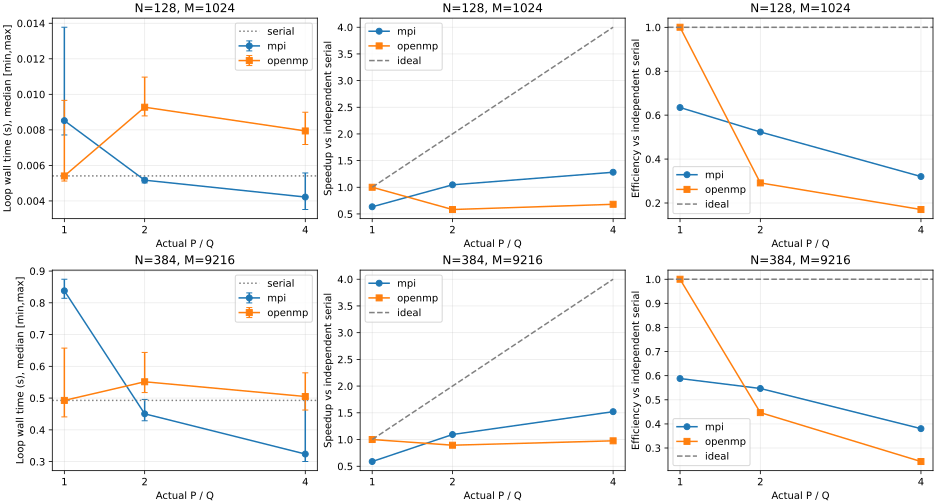
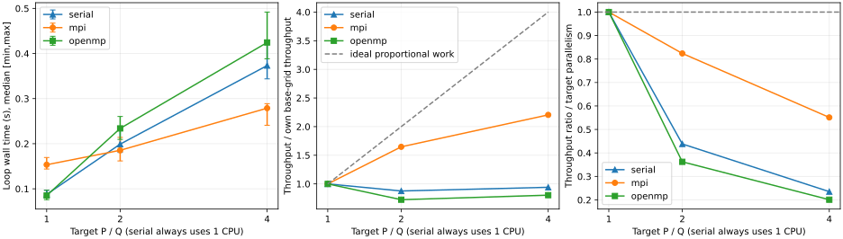

# 实验结果汇总（M4，待用户验收）

本文件统一呈现实验结论，方法见 [DESIGN](../docs/DESIGN.md)。`results/validation/` 保存构建及正确性证据，`results/performance/` 按批次保存测量与旧图，`results/figures/` 保存新版展示；`docs/` 保存设计与决策，`report/` 留待 M5，目前为空。

本轮仅迁移及绘图，没有重新运行数值回归或性能采样。历史原始记录逐字节保留，其中的旧路径由 [迁移清单](migration.json) 解释。原校验清单可用 `python3 scripts/check_results.py` 统一验证；采样源码按记录的 Git 提交核验。

| 批次 | 冻结版本 | 正式样本 | 统计口径 |
| --- | --- | ---: | --- |
| 原 M4 baseline | `75cdaad` | 23配置×5=115 | 中位数之比；时间min/max，无置信区间 |
| 补充诊断01 | `1e2fb5f` | 2560，另215次预热 | 10对比率中位数及配对bootstrap；不作正式优化结果 |
| 停止运行02 | `e715560` | 0 | 预热绑定报告被拒绝，保留失败，不纳入统计 |
| 扩大运行02-r1 | `646f7c4` | 44配置×10=440 | 同网格串行中位数之比；同轮bootstrap探索性95%区间 |

## 导航

- [原M4实验](#原m4实验)
- [补充诊断运行01](#补充诊断运行01)
- [扩大网格与并行度运行02-r1](#扩大网格与并行度运行02-r1)

## 原M4实验

# M4 性能实验结果（2026-11-11，待用户验收）

本次在冻结版本 `75cdaad9a71ef3373bd8d7ea441ae2ad3d3a9732` 上完成 23 个配置、23 次完整场验证预热及 115 条正式计时样本，每配置五次，无失败、无重试、无离群值删除。采样期间源码、协议和二进制 SHA-256 前后不变；起始工作区干净。结果限于本轮单机 WSL2、CPU 0/2/4/6 绑定、Release 配置与循环计时范围，不代表其他机器或端到端表现。

协议与完整定义见 [README](performance/baseline/README.md)、[protocol.json](performance/baseline/protocol.json)。原始证据在 [samples.jsonl](performance/baseline/run-01/samples.jsonl)、[metadata.json](performance/baseline/run-01/metadata.json)、[environment.log](performance/baseline/run-01/environment.log) 和 [complete.json](performance/baseline/run-01/complete.json)。采样日历时间记录为 Asia/Shanghai 2026-11-11 09:25:29 至 09:26:42（原始 UTC 时戳有回退现象，不能由两端相减确定总耗时，详见后文时钟核查）。所有表格来自 [summary.csv](performance/baseline/derived/summary.csv)，下表仅显示舍入值，不用显示值反算加速比。

## 正确性与计时核查

Debug/Release 完整回归各 20/20，通过原有 M1–M3 及新增计时/摘要测试；Debug 在最终测试控制逻辑后补跑 heat_timing 1/1。命令、真实输出、同次 XML 与四位小数核对见 [m4.log](validation/m4.log)。统计方法合成单元检查独立通过，八类损坏数据均拒绝；合成数字没有进入采样目录或性能表。

正式矩阵全场验证观测 D_inf 全部为 0，独立连续解析 E_inf 为 8.314784308849354e-7 至 7.4838110496466825e-6，离散正弦模态最大差 2.3381296898605797e-13；严格零边界与字段顺序通过。每个正式样本的实际 P/Q 等于请求值、参数/稳定性通过，E_inf 与该配置完整场验证差小于 1e-14。判据与容差依据见协议，不将一次零差扩大为任意输入逐位相同的保证。

MPI 每次保存 rank 绑定，预热 OpenMP Q=2/4 的运行时 affinity 诊断分别确认 CPU 0/2、0/2/4/6。libgomp 对 Q=1 的串行化团队未输出 affinity 行，故采样后另用同环境 Q=1 的真实求解作独立 /proc 探针：进程最终亲和性 CPU 0、一个 task，摘要实际 Q=1，证据及完整探针源码在 [binding-probe.json](performance/baseline/run-01/binding-probe.json)。该额外调用只验证绑定，不纳入 115 条计时样本。环境探测的 13 个命令均正常退出。

## 固定规模强扩展

T=0.01、alpha=1、r=0.16；每个表固定 N/M，p 列为已核查相等的请求/实际资源数（MPI 为 P，OpenMP 为 Q，serial 恒为 1）。Ts 为该表同一独立串行程序五次样本的中位数。S=Ts/Tp，E=S/p，MPI P=1 与 OpenMP Q=1 均未替换 Ts。时间列单位为秒，范围为五次样本最小/最大，不是置信区间。

### N=128，M=1024

| 实现 | 请求/实际 p | 中位数 s | 最小–最大 s | S | E |
| --- | --- | --- | --- | --- | --- |
| serial | 1 | 0.005406863 | 0.005138416–0.006610494 | 1.0000 | 100.00% |
| mpi | 1 | 0.008518696 | 0.007710637–0.013776413 | 0.6347 | 63.47% |
| mpi | 2 | 0.005166211 | 0.005012536–0.005284385 | 1.0466 | 52.33% |
| mpi | 4 | 0.004217559 | 0.003514440–0.005571511 | 1.2820 | 32.05% |
| openmp | 1 | 0.005404862 | 0.005117919–0.009659399 | 1.0004 | 100.04% |
| openmp | 2 | 0.009274439 | 0.008785304–0.010970525 | 0.5830 | 29.15% |
| openmp | 4 | 0.007938000 | 0.007176585–0.008990959 | 0.6811 | 17.03% |

### N=384，M=9216

| 实现 | 请求/实际 p | 中位数 s | 最小–最大 s | S | E |
| --- | --- | --- | --- | --- | --- |
| serial | 1 | 0.492738995 | 0.489257825–0.519114704 | 1.0000 | 100.00% |
| mpi | 1 | 0.837809986 | 0.814163430–0.874222782 | 0.5881 | 58.81% |
| mpi | 2 | 0.450466401 | 0.428662195–0.495735271 | 1.0938 | 54.69% |
| mpi | 4 | 0.323863468 | 0.300284119–0.498359098 | 1.5214 | 38.04% |
| openmp | 1 | 0.492711140 | 0.440762608–0.657457051 | 1.0001 | 100.01% |
| openmp | 2 | 0.551399318 | 0.517501600–0.643751093 | 0.8936 | 44.68% |
| openmp | 4 | 0.504976575 | 0.462348245–0.579582887 | 0.9758 | 24.39% |



### Amdahl 分析与实现差异

在这两组实际范围内，MPI 中位数随 P=1→2→4 下降，但相对独立串行的收益有限：小组 P=4 为 1.282 倍/32.05%，大组为 1.521 倍/38.04%。扩大固定问题改善了 MPI 的主基线效率，但没有接近理想四倍。尤其 MPI P=1 比独立串行慢，说明不能用同一 MPI 程序的 P=1 基线来替代本项目要求的独立 Ts；例如大组若误用 MPI P=1，会得到约 2.587 倍，与本表的 1.521 倍含义不同。

OpenMP 小组 Q=2/4 均慢于独立串行，大组 Q=4 的中位数也略慢（S=0.976），Q=4 比 Q=2 快不能推导出其优于串行。大组 serial 的范围为 0.489258–0.519115 s，Q=4 为 0.462348–0.579583 s，范围重叠；仅凭五次样本不能将约 2.4% 的中位数差声称为稳定的普遍退化或统计显著差异。小规模只有约 5 ms 的串行循环，调度/同步与系统抖动更易影响相对值。扩大工作并未在本轮 OpenMP 实现/绑定环境中带来主基线加速，保留这一结论，不为获得加速修改协议或筛选样本。

Amdahl 的理想模型 `S(p)=1/[f+(1−f)/p]` 解释固定规模中的不可并行部分限制，但本测量还包含通信、同步、边界处理、内核检查和系统环境效应。以主基线反推的有效 f 如下，仅作模型诊断：

| N | 实现 | p=2 的 f_eff | p=4 的 f_eff |
| --- | --- | --- | --- |
| 128 | mpi | 0.9110 | 0.7067 |
| 128 | openmp | 2.4306 | 1.6242 |
| 384 | mpi | 0.8284 | 0.5430 |
| 384 | openmp | 1.2381 | 1.0331 |

同一规模不同 p 的有效 f 不恒定，OpenMP 还出现 f_eff>1，已超出理想串行比例 [0,1] 的意义。不能将这些数当成源码中的串行占比，也不能据此预测无限核心的极限加速。MPI 存在每步两次 halo 通信，OpenMP 存在每步两处必要同步；它们与缓存访问、行分配、运行时调度和非独占 WSL 环境共同影响实际时间。这里没有通信/屏障分项剖析、硬件计数器或宿主调度证据，因此这些是可解释因素，不把某一因素断言为已量化的主要瓶颈；效率下降也不能解释为 CPU 利用率数值。

## 随并行度扩大累计工作量

固定物理域、T=0.01、alpha=1。N/M=256/4096、304/5776、362/8191 对应目标 p=1/2/4；前两组 r=0.16，最后 r=0.15998534977414236。`W=M(N−1)²`，实际 W/W1=1、1.991004、4.007846，平均 W/p 与基础配置的偏差约 0、−0.4498%、+0.1961%。最小/最大 worker 累计更新量在 summary.csv 中逐配置记录，行数取整影响没有省略。

以下 S/E 仍对照**相同规模**的独立 serial；R 则是各实现相对其**基础网格自身 p=1**的吞吐增长，`R=(W/W1)*Tp1/Tp`。R/p 是考虑实际累计更新量的归一化扩展指标，不能与主基线 E 混用。serial 始终只用 1 CPU，其 R/目标p 仅作为参考曲线，非串行程序的并行效率。

| N/M | 实现 | 目标 p / 实际 p | 中位数 s | 同规模 S | 同规模 E | 吞吐增长 R | R/目标p |
| --- | --- | --- | --- | --- | --- | --- | --- |
| 256/4096 | serial | 1/1 | 0.087637928 | 1.0000 | 100.00% | 1.0000 | 100.00% |
| 256/4096 | mpi | 1/1 | 0.153427945 | 0.5712 | 57.12% | 1.0000 | 100.00% |
| 256/4096 | openmp | 1/1 | 0.085112884 | 1.0297 | 102.97% | 1.0000 | 100.00% |
| 304/5776 | serial | 2/1 | 0.199068639 | 1.0000 | 100.00% | 0.8765 | 43.83% |
| 304/5776 | mpi | 2/2 | 0.185396790 | 1.0737 | 53.69% | 1.6477 | 82.38% |
| 304/5776 | openmp | 2/2 | 0.233925497 | 0.8510 | 42.55% | 0.7244 | 36.22% |
| 362/8191 | serial | 4/1 | 0.373278894 | 1.0000 | 100.00% | 0.9410 | 23.52% |
| 362/8191 | mpi | 4/4 | 0.278834889 | 1.3387 | 33.47% | 2.2053 | 55.13% |
| 362/8191 | openmp | 4/4 | 0.424428030 | 0.8795 | 21.99% | 0.8037 | 20.09% |

扩大工作量所有最小/最大样本范围、请求/实际 P/Q、W/p、吞吐和完整精度数值见 summary.csv；不隐去 scaled OpenMP Q=1 的 S≈1.030、E≈103.0%。这是两个独立运行程序的有限样本比率，且误差范围重叠，不能当作单线程并行效率突破的普遍事实。



### Gustafson 分析与稳定性约束

从基础到目标 p=4，MPI 总工作量增加至 4.007846 倍，时间从 0.153428 s 增至 0.278835 s；吞吐增长 2.2053 倍，归一化指标 55.13%，相同大规模独立串行基线的 S=1.3387、E=33.47%。OpenMP 时间从 0.085113 s 增至 0.424428 s，吞吐增长仅 0.8037 倍，归一化指标 20.09%；同规模 S=0.8795、E=21.99%。MPI 体现了部分吞吐扩展，但两者均未做到随工作量扩大而保持恒定推进时间。不同规模串行程序自身的更新吞吐也变化，因此不能只按 W 比例推算串行耗时，必须使用本轮同规模实测 Ts。

Gustafson `S_G=p−sigma(p−1)` 说明：若扩展时保持相近并行时间且该时间中的串行占比较小，扩大可并行工作可提高有效加速。本轮按 W≈pW1 设计，工作量增长控制在不到 0.5% 的取整偏差内，但实际时间没有保持恒定，尤其 OpenMP 的同步/调度等额外成本并未被更大工作抵消。没有单独测量 sigma，不能以公式拟合虚构串行时间占比或声称已实证 Gustafson 线性加速；本轮数据展示了该理想前提的实际局限。

二维稳定性要求 `M≥4*alpha*T*N²`。若只按 N²∝p 增加节点并维持固定 T/r，M 也近似随 p 增长，累计 W 会接近 p²，不能称每 worker 工作恒定。本轮采用 N∝p^(1/4)、M∝N²，使累计 W 近似线性增长；节点数/worker 本身无需恒定。由于 W/p 仍有取整偏差、通信量/同步次数和数据尺寸变化，本文明确称扩大工作量实验，并报告实际累计更新量，未将其笼统视为理想弱扩展。

## 证据复现与边界

```bash
python3 tests/check_statistics.py
python3 scripts/analyze_performance.py results/performance/baseline/run-01 --output build/m4-recomputed --no-plots
cmp results/performance/baseline/derived/summary.csv build/m4-recomputed/summary.csv
# 重画可选择新的输出目录；不改动 run-01 原始样本：
python3 scripts/analyze_performance.py results/performance/baseline/run-01 --output build/m4-replotted
```

独立输出目录重算 CSV 已逐字节一致；SVG/PNG 已目视核对标题、坐标、图例和范围条，理想线有明确标注，非观测数据。采样采用固定种子逐轮交错，未与本项目构建/CTest 重叠；五次样本的波动全部保留，不提供未计算的置信度或显著性结论。没有测量 P/Q>4、多机、不同绑定/调度策略、端到端性能、额外 Sanitizer、CPU 频率控制或分项性能剖析，也不把这些写为通过。

初始 /tmp 资料哈希基线在跨环境恢复后丢失，无法完整比较开工至收尾的所有资料；恢复后的 2,564 文件基线一致、课程资料始终只读且未进入 Git。来源保护核查的限制与归档修正已写入 STATUS、AI_USAGE 和 m4.log。本轮仅完成 M4 实施，验收与合并由用户决定，不进入 M5 报告/PPT。


### UTC 时间戳异常与耗时时钟核查

最终审计发现两处相邻调用的 UTC 起点差小于前一调用的 perf_counter 耗时（配置 18 预热、配置 15 第三次采样），差值分别约 −1.6631 s、−2.0152 s；后一处下一条 UTC 起点本身比上一条更早。这些差值是时钟不一致的观测，不等于已测定的精确校时幅度；未推断宿主校时或 NTP 的具体原因。原始时间戳/样本全部保留，不据 UTC 推断作业重叠，也不把始末 UTC 差当总耗时。

额外核对本机实际 libmpi/libgomp/libstdc++ 二进制：MPI_Wtime、omp_get_wtime 和 steady_clock::now 的正常路径均向 clock_gettime 传入 1，本机 Linux 头文件定义 CLOCK_MONOTONIC=1；libgomp 仅在该调用失败时有 CLOCK_REALTIME 回退分支，没有观测到此类失败。反汇编原始命令、输出、运行时库哈希与两处 UTC 异常记录见 [clock-audit.log](performance/baseline/run-01/clock-audit.log)。计时来自本地耗时差而非 UTC 起点，时戳回退本身不能证明循环耗时失效；保留全部原始结果和环境局限，不将其删除以美化图表。

同一采样脚本逐个阻塞等待 process.communicate()，返回并完成检查后才调用下一配置，因此程序组织是顺序的；未保存每个调用的独立单调起点时间线，不能声称已由时戳独立重建了无重叠过程。此处通过冻结源码及实际记录解释证据边界，未将日历时间异常掩盖为正常。


## 补充诊断运行01

### M4 补充诊断实测结果（运行 01，2026-11-11，待用户验收）

冻结诊断版本 `1e2fb5fd955867cecb372c17f889eb32e15cd6b0`。本次共 2775 次求解调用，其中完整场验证预热 215 次、正式计时 2560 次；原矩阵复测为 23 配置×10 次=230 样本，另有副本/插桩校准、触发的对照与粒度矩阵。所有成功样本参数、实际 P/Q、绑定与稳定性已核验；单调起止时间线逐次无重叠，源码/二进制采样前后哈希未变。原 M4 数据及正式求解器未改。本节是新增诊断分析，不替代原性能结果。

完整场验证最大 D_inf=0，最大离散模态差=5.0059956180348308e-13；每个新网格使用独立的模态截断误差界核查解析误差，未套用旧矩阵统一 E_inf 上限。

原始记录见 [JSONL](performance/diagnostic-01/m4-diagnostic-01.jsonl)、[配置/版本/决策清单](performance/diagnostic-01/m4-diagnostic-01.json)、[环境/编译报告/反汇编](performance/diagnostic-01/m4-diagnostic-01.log)。统计见 [CSV](performance/diagnostic-01/m4-diagnostic-01.csv)，各 rank/thread 分项见 [worker CSV](performance/diagnostic-01/m4-diagnostic-01-workers.csv)，对照图见 [SVG](performance/diagnostic-01/m4-diagnostic-01.svg)。每个 attempt 都先落盘，再校验并写入 sample；统计只取 sample 的正式记录，不重复计算 attempt。所有原始及派生证据位于既有目录，没有新增 Markdown 文档或目录。

#### 原矩阵复测

本表使用原路径 baseline 的 10 次中位数。S/E 均以同一行 N/M 的独立串行中位数为主基线；MPI P=1 未替换 Ts。范围仅为实测最小/最大，配对区间见后续对照，不能据范围重叠或分离宣称总体显著性。

| N/M | 实现 | 实际 p | 中位数 s | 最小–最大 s | 同规模 S | E | 前3/末3中位数 |
| --- | --- | --- | --- | --- | --- | --- | --- |
| 128/1024 | mpi | 1 | 0.008976721 | 0.008660542–0.010640404 | 0.6233 | 62.33% | 1.0108 |
| 128/1024 | mpi | 2 | 0.005550767 | 0.005302760–0.005919543 | 1.0081 | 50.40% | 1.0223 |
| 128/1024 | mpi | 4 | 0.004484607 | 0.003624609–0.004657707 | 1.2477 | 31.19% | 0.8070 |
| 128/1024 | openmp | 1 | 0.006123388 | 0.005815113–0.007352387 | 0.9138 | 91.38% | 0.9789 |
| 128/1024 | openmp | 2 | 0.009959034 | 0.009067839–0.011827709 | 0.5618 | 28.09% | 0.9321 |
| 128/1024 | openmp | 4 | 0.007863004 | 0.007091796–0.010428478 | 0.7116 | 17.79% | 1.0545 |
| 128/1024 | serial | 1 | 0.005595452 | 0.005210102–0.007317865 | 1.0000 | 100.00% | 1.0020 |
| 256/4096 | mpi | 1 | 0.153215757 | 0.148465744–0.170349614 | 0.5955 | 59.55% | 1.0369 |
| 256/4096 | openmp | 1 | 0.096480594 | 0.091775158–0.105926784 | 0.9457 | 94.57% | 1.0285 |
| 256/4096 | serial | 1 | 0.091237198 | 0.085602129–0.107844299 | 1.0000 | 100.00% | 1.0281 |
| 304/5776 | mpi | 2 | 0.189162009 | 0.185148256–0.201449177 | 1.0453 | 52.27% | 0.9962 |
| 304/5776 | openmp | 2 | 0.235798864 | 0.201070829–0.263173821 | 0.8386 | 41.93% | 1.0467 |
| 304/5776 | serial | 1 | 0.197733752 | 0.185602781–0.204931170 | 1.0000 | 100.00% | 1.0043 |
| 362/8191 | mpi | 4 | 0.220046013 | 0.209637141–0.245682163 | 1.7700 | 44.25% | 0.9764 |
| 362/8191 | openmp | 4 | 0.389118934 | 0.311906277–0.442121843 | 1.0009 | 25.02% | 0.9185 |
| 362/8191 | serial | 1 | 0.389476409 | 0.367829428–0.421719298 | 1.0000 | 100.00% | 0.9734 |
| 384/9216 | mpi | 1 | 0.854212920 | 0.806287525–0.879163683 | 0.5867 | 58.67% | 1.0167 |
| 384/9216 | mpi | 2 | 0.459403497 | 0.450915757–0.481236164 | 1.0910 | 54.55% | 1.0134 |
| 384/9216 | mpi | 4 | 0.298291131 | 0.272666573–0.329646413 | 1.6802 | 42.01% | 0.9528 |
| 384/9216 | openmp | 1 | 0.500346138 | 0.478383977–0.520370004 | 1.0017 | 100.17% | 0.9915 |
| 384/9216 | openmp | 2 | 0.559240207 | 0.513556215–0.612062041 | 0.8962 | 44.81% | 0.9512 |
| 384/9216 | openmp | 4 | 0.478625746 | 0.417847365–0.565145043 | 1.0471 | 26.18% | 1.1663 |
| 384/9216 | serial | 1 | 0.501190138 | 0.470440735–0.561422543 | 1.0000 | 100.00% | 0.9364 |

最后一列只是预设早期偏慢触发量，不是统计检验。十轮逐样本顺序及慢样本全部保留在JSONL的reproduce/repetition字段，无截尾或热机后重取。

| 原异常 | 本轮复现与判断 |
| --- | --- |
| N=128 MPI单进程偏慢、OpenMP多线程效率 | MPI1/独立串行耗时=1.604；OpenMP Q4的S=0.712、E=17.79%；Q2/Q4耗时=1.267，Q4更快。低效率仍在。 |
| N=384 MPI单进程偏慢、OpenMP多线程效率 | MPI1/独立串行耗时=1.704；OpenMP Q4的S=1.047、E=26.18%；Q2/Q4耗时=1.168，Q4更快。低效率仍在。 |
| mpi扩大工作量吞吐 | p=1/2/4实测吞吐=1.7383/2.8034/4.8511 Gupdate/s；相对自身p1增长=1.6127/2.7906，p4归一化=69.77%。这不是与同规模独立串行的加速比。 |
| openmp扩大工作量吞吐 | p=1/2/4实测吞吐=2.7606/2.2489/2.7433 Gupdate/s；相对自身p1增长=0.8146/0.9937，p4归一化=24.84%。这不是与同规模独立串行的加速比。 |

大网格Q4相对串行的微小收益与原M4略慢不同，不能把是否跨过S=1当稳定门槛。扩大工作量时OpenMP仍无接近p倍的吞吐增长，但原M4“p4较基础网格吞吐下降”的幅度没有稳定复现，不能用旧样本单独证明规模越大必然越慢。十轮中N384/Q4前3/末3超过1.1，早期偏慢触发仍存在；CPU对照见后文，宿主环境部分未定。MPI多进程的通信/等待与有限每步粒度也仍消耗时间，公共内核和行划分对照不能解释全部扩展损失。

#### 两层校准与分项解释范围

副本差异为 replica/baseline 的中位数之比减 1，插桩差异为 profiled/unprofiled replica 的中位数之比减 1；两项绝对值均不超过 5% 才允许分项作为原路径的定量线索。百分比是校准样本本身的度量，不等于统计显著性，也不能保证跨阶段环境不变。分项比例先在每次调用的最慢 worker 内计算，再取中位数，不相加不同 worker 的最大值。update 包含内存访问等待，communication 包含邻居等待；OpenMP sync+exchange 包括整层等待与角色交换同步。OpenMP的loop_seconds包含一次团队进入/退出，worker.total仅覆盖团队内循环；分项比例不能用来推算团队创建成本。初始化、结果重建/收集、数值验证及输出在推进计时外；MPI推进含halo并取rank最大值，计时后的最大值归约不计入推进。

| 实现/资源 | 副本差异 | 插桩差异 | 更新占比 | 通信占比 | sync+exchange占比 | 解释范围 |
| --- | --- | --- | --- | --- | --- | --- |
| serial1 | +3.93% | -2.69% | 97.11% | 0.00% | 0.06% | 可作定量线索 |
| mpi1 | -0.28% | +2.42% | 99.72% | 0.11% | 0.06% | 可作定量线索 |
| mpi2 | +0.43% | +2.85% | 90.57% | 9.22% | 0.08% | 可作定量线索 |
| mpi4 | -3.81% | +3.66% | 75.22% | 24.41% | 0.14% | 可作定量线索 |
| openmp1 | -0.97% | +1.93% | 99.03% | 0.00% | 0.93% | 可作定量线索 |
| openmp2 | -0.44% | -1.60% | 87.99% | 0.00% | 11.93% | 可作定量线索 |
| openmp4 | +0.21% | +1.96% | 89.03% | 0.00% | 10.81% | 可作定量线索 |

以下对照统一为同一配置的未插桩 A/B 配对中位数比；>1 表示 B 更快。括号为固定种子、10000 次配对 bootstrap 百分位95%区间，属于探索性区间，未作多重比较校正。满足判据指预先记录的5%幅度、至少8/10对同向、区间不跨1；不构成唯一根因或总体显著性的证明。copy/profile校准及全部对照的未舍入值在CSV中保留。

#### MPI 单进程计算上下文与空邻居调用

| 对照 | A/B [95%探索性区间]与判据 |
| --- | --- |
| null mpi1 | 1.0101 [0.9936, 1.0284]；未满足 |
| common serial1 | 1.0553 [1.0093, 1.0839]；满足判据 |
| common mpi1 | 1.5832 [1.4818, 1.6931]；满足判据 |

公共内核B侧中位数：串行0.540856358s、MPI1 0.565156837s，描述性残余耗时比为1.045；这是跨阶段中位数，不能当作配对效果量或宣称MPI开销已完全消除。原路径同规模复测MPI1/串行耗时比为1.704。

未检测到跳过 MPI_PROC_NULL 调用产生预设幅度的可重复影响，因而空邻居调用未获支持为本轮主要差距来源；不将其说成绝对零开销。公共行内核只改变计算执行上下文，保留 MPI 分配、halo 调用和边界策略；该对照与原MPI热循环额外逐向量栈写入的反汇编证据共同支持“计算内核代码生成上下文”这一解释。原串行和MPI均已向量化，不能以是否向量化二分归因。没有直接测量单条栈写入的成本，也不能证明它解释全部差距；公共内核对照串行与MPI的测量时间不完全同时，跨阶段残余差距只作辅助观察。

#### OpenMP 行划分与同步交互

每格给出A/B比率、区间及判据；四列分别固定另一因素进行对照。不能把几个收益直接相乘当成相对原程序的预测。

| N | Q | 循环→连续（原同步） | 循环下双同步→私有指针 | 连续下双同步→私有指针 | 私有指针下循环→连续 |
| --- | --- | --- | --- | --- | --- |
| 128 | 2 | 2.7249 [2.4038, 2.8464]；满足判据 | 1.0103 [0.9815, 1.0585]；未满足 | 1.1064 [1.0382, 1.3406]；满足判据 | 2.9965 [2.8290, 3.0927]；满足判据 |
| 128 | 4 | 2.9391 [2.6115, 3.1604]；满足判据 | 1.0098 [0.9694, 1.0651]；未满足 | 1.2053 [1.1068, 1.4240]；满足判据 | 2.9757 [1.9843, 3.1542]；满足判据 |
| 384 | 2 | 1.9506 [1.8873, 2.0256]；满足判据 | 0.9964 [0.9793, 1.0160]；未满足 | 1.0555 [1.0075, 1.0690]；满足判据 | 1.9717 [1.8916, 2.0164]；满足判据 |
| 384 | 4 | 2.7626 [2.6249, 2.8491]；满足判据 | 1.0193 [1.0001, 1.0463]；未满足 | 1.0602 [1.0235, 1.0927]；满足判据 | 2.7009 [2.5203, 2.9440]；满足判据 |

连续行分配相对 static,1 的稳定收益支持行划分是重要实施因素。循环划分下仅去掉共享角色交换的一处同步未达到判据，而连续划分后存在较小附加收益，说明同步与访问/分配方式存在交互；不能单独归为“屏障太多”。这些是对实际代码变体的因果对照。代码归属关系可直接推导：static,1 时行 i 归线程 (i−1)%Q，Q>1 时其非边界垂直邻行由其他线程产生；连续划分时，大多数垂直邻居位于同一线程子区，仅分区交界的依赖跨线程。连续划分因而提供更集中的数据生产/消费关系，为局部性解释提供机制依据；这不是实际缓存未命中或缓存通信字节数的测量，循环控制代码与硬件缓存等更细机制仍未完全分离。

#### 布局、等待与 CPU 对照

| 阶段 | 对照 | A/B [95%探索性区间]与判据 |
| --- | --- | --- |
| layout | q2-replica/padded | 0.9884 [0.9550, 1.0034]；未满足 |
| layout | q2-block/block-padded | 1.0218 [0.9623, 1.0730]；未满足 |
| layout | q4-replica/padded | 1.0121 [0.9810, 1.0357]；未满足 |
| layout | q4-block/block-padded | 1.0596 [1.0192, 1.0809]；满足判据 |
| wait | q2 | 0.6624 [0.6556, 0.6679]；满足判据 |
| wait | q4 | 0.4733 [0.4576, 0.4815]；满足判据 |
| cpu | 0/2 | 0.9947 [0.9297, 1.0346]；未满足 |
| cpu | 0/4 | 0.9930 [0.9766, 1.0191]；未满足 |
| cpu | 0/6 | 1.0070 [0.9798, 1.0432]；未满足 |
| cpu | 0/8 | 1.0025 [0.9622, 1.0148]；未满足 |
| cpu | 0/10 | 1.0065 [0.9851, 1.0208]；未满足 |
| cpu | 0/12 | 1.0016 [0.9601, 1.0450]；未满足 |
| cpu | 0/14 | 1.0027 [0.9821, 1.0183]；未满足 |

单纯64字节对齐/填充未在循环划分下复现连续分配的主要收益，不支持把主因直接定为行边界伪共享；连续划分下个别布局影响单独保留。PASSIVE等待相对ACTIVE变慢，说明本轮原ACTIVE设置没有显示出待修正的性能问题，不把其他机器的等待策略结论套入本机。CPU 0至14的所选8个单核对照均未满足判据，因此按协议跳过CPU分组扩展；这不能排除全部宿主调度、频率或虚拟化影响，早期偏慢的环境部分仍未确定。

#### 粒度与步数验证

原路径每个网格/资源组合保留10次样本。表中A/B是replica与选中变体的独立10对，baseline列只显示原路径中位数，不把副本/变体间的配对比率冒充相对原路径加速。全部配置见CSV，表中展示MPI单进程和OpenMP多线程的重点组合。

| 矩阵 | N/M/T | 实现/p | 原baseline s | replica/变体比率与区间 |
| --- | --- | --- | --- | --- |
| fixed-M | 128/9216/0.005 | mpi/1 | 0.089171143 | 1.5513 [1.3686, 1.6376]；满足判据 |
| fixed-M | 128/9216/0.005 | openmp/2 | 0.083895812 | 2.5718 [1.9747, 2.7860]；满足判据 |
| fixed-M | 128/9216/0.005 | openmp/4 | 0.069324061 | 3.1917 [3.1010, 3.4110]；满足判据 |
| fixed-M | 256/9216/0.005 | mpi/1 | 0.351859158 | 1.6951 [1.6316, 1.7767]；满足判据 |
| fixed-M | 256/9216/0.005 | openmp/2 | 0.255643856 | 2.1547 [1.9611, 2.2742]；满足判据 |
| fixed-M | 256/9216/0.005 | openmp/4 | 0.286642345 | 2.7880 [2.6728, 3.1269]；满足判据 |
| fixed-M | 384/9216/0.005 | mpi/1 | 0.824540528 | 1.6665 [1.6266, 1.7297]；满足判据 |
| fixed-M | 384/9216/0.005 | openmp/2 | 0.561418239 | 1.9766 [1.9110, 2.0133]；满足判据 |
| fixed-M | 384/9216/0.005 | openmp/4 | 0.501432966 | 2.6211 [2.5151, 2.7331]；满足判据 |
| fixed-M | 512/9216/0.005 | mpi/1 | 1.578299677 | 1.5465 [1.5105, 1.5892]；满足判据 |
| fixed-M | 512/9216/0.005 | openmp/2 | 1.014757035 | 1.8619 [1.8085, 1.8943]；满足判据 |
| fixed-M | 512/9216/0.005 | openmp/4 | 0.871857696 | 2.5637 [2.3632, 2.6650]；满足判据 |
| fixed-N | 384/1024/0.001 | mpi/1 | 0.093867477 | 1.7179 [1.6051, 1.7451]；满足判据 |
| fixed-N | 384/1024/0.001 | openmp/2 | 0.054156699 | 1.8995 [1.8293, 1.9879]；满足判据 |
| fixed-N | 384/1024/0.001 | openmp/4 | 0.053533289 | 2.8110 [2.6793, 2.9682]；满足判据 |
| fixed-N | 384/4096/0.001 | mpi/1 | 0.370449616 | 1.6410 [1.6233, 1.6720]；满足判据 |
| fixed-N | 384/4096/0.001 | openmp/2 | 0.247778737 | 1.8914 [1.7918, 1.9531]；满足判据 |
| fixed-N | 384/4096/0.001 | openmp/4 | 0.212284533 | 2.8088 [2.6936, 2.9180]；满足判据 |
| fixed-N | 384/16384/0.001 | mpi/1 | 1.432582647 | 1.6757 [1.6234, 1.7081]；满足判据 |
| fixed-N | 384/16384/0.001 | openmp/2 | 1.011833952 | 1.9865 [1.9283, 2.0101]；满足判据 |
| fixed-N | 384/16384/0.001 | openmp/4 | 0.916312935 | 2.6982 [2.5929, 2.7804]；满足判据 |

粒度对照满足判据的配置数（非独立重复检验、未作多重比较校正）：serial 2/7；mpi 21/21；openmp 15/21；未满足者也全部保留。

MPI common在全部21个资源/粒度组合上满足正向影响判据；OpenMP block的14个多线程组合均满足正向判据，单线程N256/M9216则出现反向影响（A/B=0.9355），其余单线程未满足判据。因此不主张该行划分对单线程也保证获益。两种主要多线程/多进程影响在不同步数仍保留，支持逐层执行因素，不能仅用一次团队创建成本解释；未精确拟合该固定成本。

两组矩阵分别固定步数或每步网格，T/r与原M4部分条件不同，使用真实稳定输入和同配置对照解释；不替换原强扩展/扩大工作量数据。变体按冻结规则选择，不因某个样本更快重新筛选。固定网格时CPU工作和同步成本均随步数累积，不能简单把拟合截距等同团队创建成本；固定步数改变工作集和每步计算，也不能单独证明带宽饱和。各网格判据是否满足以表与原始记录为准，不把一个规模的效果保证推广到所有参数。

#### 归因边界与复现

本轮支持的重要实施因素是MPI的计算内核执行/编译上下文与OpenMP行划分；部分同步和布局收益取决于已有划分。空邻居通信没有显示足够影响，PASSIVE等待变慢，所选CPU集合未解释主要差距。Q=4快于Q=2本身符合资源增加可能缩短耗时的趋势，不能据此推导效率更高或优于独立串行。未测直接硬件事件，缓存/带宽/伪共享和宿主机制不当作已精确测定的根因；原环境波动及剩余差距保留为未确定。

构建/正确性证据见 [Debug](validation/m4-diagnostic-debug-checks.log)、[Release](validation/m4-diagnostic-release-checks.log)（各21/21）、[默认OFF配置发现及合成联调](validation/m4-diagnostic-default-checks.log)。原20项保留；诊断OFF仍20项，发现检查不等于该目录实际测试执行。统计图的蓝点仅表示探索性判据满足，灰点表示未满足；横线是配对bootstrap区间，含义不同于旧M4图的原始min/max范围。所有数据来自真实调用，合成测试数据未混入。

复现命令：`python3 scripts/diagnose.py --build build/m4-diagnostic-release --run-id <新编号>`；重算命令：`python3 scripts/analyze_diagnostics.py results/performance/diagnostic-01/m4-diagnostic-01 --output build/m4-diagnostic-recomputed --no-plots`。新运行编号拒绝覆盖；CSV可与归档逐字节比较，图表由同一脚本生成。正式程序源码与原性能目录保持不变；是否采用任何诊断变体仍由用户决定，未进入M5。


## 扩大网格与并行度运行02-r1

### 扩大网格与并行度实测结果（运行02-r1，2026-11-11，待用户验收）

冻结采样版本 `646f7c460d5a2b409c1063face7e7ed7655db5fc`，只运行原heat_serial、heat_mpi、heat_openmp。完成44配置、44次完整场验证预热和440次正式样本，当前完成运行没有失败、重试或样本剔除；所有慢样本保留。初次02在单rank绑定报告检查处停止，0正式样本，证据完整保留；02与02-r1没有混合统计。实际P/Q、绑定和稳定性逐次核验，单调调用区间无重叠，采样前后源码/二进制哈希一致。

所有预热全场观测最大D_inf=0，最大离散模态差=6.638023464233811e-13；解析误差E_inf范围1.1692579471311859e-07至8.3147843088493545e-07。CSV逐行核查的坐标、边界、字段、解析与串行参考均通过；仅记录验证摘要和输出哈希，成功临时全场文件不作为正式计时数据。

证据：[清单与代码/编译身份](performance/large-02-r1/m4-diagnostic-02-r1.json)、[原始attempt/sample](performance/large-02-r1/m4-diagnostic-02-r1.jsonl)、[环境](performance/large-02-r1/m4-diagnostic-02-r1.log)、[控制台](performance/large-02-r1/m4-diagnostic-02-r1-console.log)、[统计](performance/large-02-r1/m4-diagnostic-02-r1.csv)、[逐轮统计](performance/large-02-r1/m4-diagnostic-02-r1-rounds.csv)、[审计](performance/large-02-r1/m4-diagnostic-02-r1-audit.log)、[哈希清单](performance/large-02-r1/m4-diagnostic-02-r1.sha256)。初次失败见[02留证](performance/large-02/m4-diagnostic-02-failure.log)，其完整全场CSV与原attempt SHA-256一致。新增检查及原21项日志独立保留，不把检查耗时或合成数据纳入下表。

#### 四组固定规模强扩展

T=0.01、alpha=1、r=0.16，M=N²/16。每个N分别用该网格10次独立串行的中位数作主基线。时间范围为真实min/max，S的区间为同轮共同重采样10000次的探索性95%区间；E=S/实际p，区间相应除以p。未进行多重比较校正或把区间当唯一因果证明。16使用14个WSL可见core上的16逻辑CPU，含core0/1各两个硬件线程，不能作为16个独立物理核心解读。

| N/M | 实现 | 请求/实际p | 中位数s | min–max s | S [95%区间] | E |
| --- | --- | --- | --- | --- | --- | --- |
| 384/9216 | serial | 1/1 | 0.523949631 | 0.493198828–0.782286139 | 1.0000 [1.0000, 1.0000] | 100.00% |
| 384/9216 | mpi | 1/1 | 0.919761930 | 0.830404261–1.187594647 | 0.5697 [0.4713, 0.5992] | 56.97% |
| 384/9216 | mpi | 2/2 | 0.470790887 | 0.423003374–0.614724757 | 1.1129 [1.0548, 1.1300] | 55.65% |
| 384/9216 | mpi | 4/4 | 0.309420250 | 0.267583116–0.455013324 | 1.6933 [1.4077, 1.7737] | 42.33% |
| 384/9216 | mpi | 8/8 | 0.227695430 | 0.168817030–0.347752873 | 2.3011 [1.7691, 2.8612] | 28.76% |
| 384/9216 | mpi | 16/16 | 0.150191594 | 0.109306687–0.304684938 | 3.4885 [2.3364, 4.6194] | 21.80% |
| 384/9216 | openmp | 1/1 | 0.514654901 | 0.482583355–0.750701852 | 1.0181 [0.8455, 1.0228] | 101.81% |
| 384/9216 | openmp | 2/2 | 0.541411740 | 0.498924834–0.634831198 | 0.9677 [0.9038, 1.0323] | 48.39% |
| 384/9216 | openmp | 4/4 | 0.526559821 | 0.487841394–0.583967536 | 0.9950 [0.9075, 1.0512] | 24.88% |
| 384/9216 | openmp | 8/8 | 0.458296168 | 0.388456042–0.742785209 | 1.1433 [1.0945, 1.2397] | 14.29% |
| 384/9216 | openmp | 16/16 | 0.440526775 | 0.386460553–0.844707547 | 1.1894 [1.0821, 1.2977] | 7.43% |
| 512/16384 | serial | 1/1 | 1.821371560 | 1.678229696–2.018582274 | 1.0000 [1.0000, 1.0000] | 100.00% |
| 512/16384 | mpi | 1/1 | 2.836574794 | 2.719999739–3.995149799 | 0.6421 [0.5047, 0.6748] | 64.21% |
| 512/16384 | mpi | 2/2 | 1.682162609 | 1.541722122–2.569043564 | 1.0828 [0.9391, 1.1743] | 54.14% |
| 512/16384 | mpi | 4/4 | 1.073462493 | 0.819577317–1.632031709 | 1.6967 [1.6191, 1.9457] | 42.42% |
| 512/16384 | mpi | 8/8 | 0.737584146 | 0.613462186–1.478342625 | 2.4694 [2.1951, 2.6898] | 30.87% |
| 512/16384 | mpi | 16/16 | 0.646270770 | 0.434722482–1.222990773 | 2.8183 [2.0230, 4.0240] | 17.61% |
| 512/16384 | openmp | 1/1 | 1.836893031 | 1.732377855–2.471117605 | 0.9916 [0.8924, 1.0638] | 99.16% |
| 512/16384 | openmp | 2/2 | 1.836532352 | 1.708153313–2.456601217 | 0.9917 [0.8842, 1.0675] | 49.59% |
| 512/16384 | openmp | 4/4 | 1.621174386 | 1.491095095–2.570794711 | 1.1235 [1.0728, 1.2166] | 28.09% |
| 512/16384 | openmp | 8/8 | 1.458121316 | 1.246155807–2.477585339 | 1.2491 [1.1674, 1.4001] | 15.61% |
| 512/16384 | openmp | 16/16 | 1.464065101 | 1.257984051–2.419307640 | 1.2441 [1.1820, 1.4052] | 7.78% |
| 768/36864 | serial | 1/1 | 9.109237842 | 8.596138779–13.404883570 | 1.0000 [1.0000, 1.0000] | 100.00% |
| 768/36864 | mpi | 1/1 | 14.723569571 | 13.763174515–20.046977109 | 0.6187 [0.5621, 0.6696] | 61.87% |
| 768/36864 | mpi | 2/2 | 8.692143186 | 8.416302472–12.399465183 | 1.0480 [1.0348, 1.1060] | 52.40% |
| 768/36864 | mpi | 4/4 | 5.670915996 | 4.832093592–8.192991181 | 1.6063 [1.5800, 1.8363] | 40.16% |
| 768/36864 | mpi | 8/8 | 3.866162190 | 2.801060387–5.088510600 | 2.3561 [2.2692, 2.6659] | 29.45% |
| 768/36864 | mpi | 16/16 | 3.077842496 | 1.959728481–5.331928172 | 2.9596 [2.0182, 3.5426] | 18.50% |
| 768/36864 | openmp | 1/1 | 9.211786097 | 8.445171119–13.725566603 | 0.9889 [0.9336, 1.1204] | 98.89% |
| 768/36864 | openmp | 2/2 | 9.222647609 | 8.727613691–13.715757157 | 0.9877 [0.8736, 1.0966] | 49.39% |
| 768/36864 | openmp | 4/4 | 7.889493505 | 6.673885921–8.722584329 | 1.1546 [1.0940, 1.2958] | 28.87% |
| 768/36864 | openmp | 8/8 | 7.314733771 | 6.078932766–8.839104457 | 1.2453 [1.1786, 1.4888] | 15.57% |
| 768/36864 | openmp | 16/16 | 6.477599253 | 5.081535497–11.610108403 | 1.4063 [1.2423, 1.5932] | 8.79% |
| 1024/65536 | serial | 1/1 | 35.389156603 | 32.044813011–43.451894320 | 1.0000 [1.0000, 1.0000] | 100.00% |
| 1024/65536 | mpi | 1/1 | 48.315583805 | 46.039405623–63.803365026 | 0.7325 [0.6617, 0.7521] | 73.25% |
| 1024/65536 | mpi | 2/2 | 29.395860213 | 27.444051335–39.391634230 | 1.2039 [1.1037, 1.2696] | 60.19% |
| 1024/65536 | mpi | 4/4 | 18.521626115 | 17.413138790–21.825735434 | 1.9107 [1.7242, 2.0474] | 47.77% |
| 1024/65536 | mpi | 8/8 | 13.406469821 | 11.031274174–20.427077712 | 2.6397 [2.3785, 2.8425] | 33.00% |
| 1024/65536 | mpi | 16/16 | 10.566213652 | 9.330659935–18.348607141 | 3.3493 [2.2610, 3.5891] | 20.93% |
| 1024/65536 | openmp | 1/1 | 35.468884586 | 31.909356414–44.454507535 | 0.9978 [0.9157, 1.0545] | 99.78% |
| 1024/65536 | openmp | 2/2 | 28.273565013 | 27.665590727–39.752970960 | 1.2517 [1.1490, 1.3204] | 62.58% |
| 1024/65536 | openmp | 4/4 | 24.647890233 | 23.492694994–26.284592950 | 1.4358 [1.3698, 1.4863] | 35.89% |
| 1024/65536 | openmp | 8/8 | 19.669246715 | 18.528954480–23.927288280 | 1.7992 [1.6676, 1.8423] | 22.49% |
| 1024/65536 | openmp | 16/16 | 21.438211412 | 17.955480011–25.426394570 | 1.6508 [1.5076, 1.8035] | 10.32% |

[强扩展图](performance/large-02-r1/m4-diagnostic-02-r1-strong.svg)从左到右为耗时、中位数之比加速比和效率；耗时线段是min/max，S/E线段是探索性区间，两者含义不同。理想线是参考，不是测得结果。效率是速度比除执行单元数，不是CPU利用率。

#### 增加N后，同样人数的收益如何变化

| 实现 | 实际p | N384 S | N512 S | N768 S | N1024 S |
| --- | --- | --- | --- | --- | --- |
| mpi | 1 | 0.5697 | 0.6421 | 0.6187 | 0.7325 |
| mpi | 2 | 1.1129 | 1.0828 | 1.0480 | 1.2039 |
| mpi | 4 | 1.6933 | 1.6967 | 1.6063 | 1.9107 |
| mpi | 8 | 2.3011 | 2.4694 | 2.3561 | 2.6397 |
| mpi | 16 | 3.4885 | 2.8183 | 2.9596 | 3.3493 |
| openmp | 1 | 1.0181 | 0.9916 | 0.9889 | 0.9978 |
| openmp | 2 | 0.9677 | 0.9917 | 0.9877 | 1.2517 |
| openmp | 4 | 0.9950 | 1.1235 | 1.1546 | 1.4358 |
| openmp | 8 | 1.1433 | 1.2491 | 1.2453 | 1.7992 |
| openmp | 16 | 1.1894 | 1.2441 | 1.4063 | 1.6508 |

[网格对比图](performance/large-02-r1/m4-diagnostic-02-r1-grid.svg)显示相同人数的S随N变化；每点均有同规模实测串行基线。跨N时M也增加，累计W约随N⁴增长，不能把全部变化单独归为每步粒度，也不把该矩阵称为弱扩展或新增Gustafson实证。

#### 8与16，以及本轮最快配置

本表是本轮中位数的描述性比较，没有为T8/T16另计算区间，也未按最快配置剔除其他数据。T8/T16>1表示16组中位数更短，<1表示8组更短。最佳p只是在这五个已测配置中取最大S，不是对其他机器或输入的推荐。

| N | 实现 | T8/T16 | 最短中位数对应p | 该配置S/E |
| --- | --- | --- | --- | --- |
| 384 | mpi | 1.5160 | 16 | 3.4885 / 21.80% |
| 384 | openmp | 1.0403 | 16 | 1.1894 / 7.43% |
| 512 | mpi | 1.1413 | 16 | 2.8183 / 17.61% |
| 512 | openmp | 0.9959 | 8 | 1.2491 / 15.61% |
| 768 | mpi | 1.2561 | 16 | 2.9596 / 18.50% |
| 768 | openmp | 1.1292 | 16 | 1.4063 / 8.79% |
| 1024 | mpi | 1.2688 | 16 | 3.3493 / 20.93% |
| 1024 | openmp | 0.9175 | 8 | 1.7992 / 22.49% |

16增加了逻辑执行单元，也改变了同core线程共享情况；未增加14人或其他CPU布局对照，不能将8/16差异精确归因于共享、带宽或算法中的某一因素。原程序仍含运行01诊断支持的计算/行划分因素，本轮没有应用这些变体，不能用本轮曲线孤立证明或排除原有因素。

#### 波动、方法及复现边界

[逐轮图](performance/large-02-r1/m4-diagnostic-02-r1-rounds.svg)保留全部10轮，以各配置中位数归一化，方便观察慢样本与轮次变化；原始秒数在rounds.csv和JSONL中保留。前3/末3中位数仅是描述性趋势量，不作自动删样本规则。没有锁定宿主频率、P/E核映射或独占资源，环境和具体硬件机制仍有未确定部分，不从S强行反推真实串行代码比例。

原正式求解器、CMake、既有脚本/测试、原docs/performance及运行01证据保持不变；本轮没有调用诊断求解器，不进入M5。Debug/Release原21项及新增扩展检查通过；单rank报告修正后，新增检查在两构建覆盖全部P/Q并再次通过，原21项日志保留，不冒充重跑过的测试。初次失败和MPI超时清理的开发失败也分别保留。

重算入口：`python3 scripts/analyze_large.py results/performance/large-02-r1/m4-diagnostic-02-r1 --output build/m4-large-recomputed --no-plots`。CSV与rounds.csv在独立前缀重算逐字节一致；图表由同一已冻结脚本生成。复现实验用`python3 scripts/benchmark_large.py --build build/m4-large-release --run-id <未使用编号>`，先完成检查并提交干净源码；不覆盖02或02-r1。


#### 对本轮问题的回答

扩大网格数量对当前OpenMP程序有一定帮助：Q=8的S从N384的1.1433增至N1024的1.7992，Q=4从0.9950增至1.4358，Q=16从1.1894增至1.6508；中间网格并非所有曲线都单调。MPI P=4/8在最大网格的S分别为1.9107/2.6397，较N384的1.6933/2.3011有所提高，但P=16为3.4885→2.8183→2.9596→3.3493，没有呈现网格越大收益必然越高。这里比较的是点估计趋势，未为跨网格的S变化额外构造区间或作因果检验。

增加MPI进程数在四个网格上均降低了中位耗时，已测最快均为P=16；N1024的独立串行为35.3892s，MPI16为10.5662s，S=3.3493、E=20.93%。OpenMP增加线程的收益有限且存在回落；N1024下Q=8为19.6692s、S=1.7992、E=22.49%，Q=16为21.4382s、S=1.6508、E=10.32%，本轮中位数下8线程更快。未为8/16直接比率单独计算区间，不能据一个比率宣称其在所有运行中稳定优胜。

最大网格的串行推进已达数十秒，MPI单进程仍比独立串行慢（48.3156s对35.3892s）。因此“只因总耗时太短”不足以解释全部差距。每步粒度、必要通信/同步、既有计算上下文与行划分、资源共享和环境变化仍需区分；运行01的受控变体提供具体实施因素证据，本轮规模矩阵没有精确分离这些机制，也没有应用优化。原C++实现及计时边界始终保持。

逐轮数据的34/44个配置出现前3/末3中位数>1.1，描述性比率范围0.8389–1.9825，显示明显轮次趋势而非可宣称完全平稳的测量。全部早期/慢样本保留；同轮bootstrap保留轮次配对，不能消除轮内时变因素或证明宿主状态已稳定。本轮按冻结矩阵完成，不因这些趋势追加未经选择的CPU/等待/诊断变体实验。

时钟审计进一步发现11处相邻调用UTC起点回退，146次调用的UTC/单调区间差绝对值超过1s；UTC结束还包含读取输出/哈希后处理，后者计数不能解释为精确校时次数。从首调用起点到末调用终点，单调跨度5193.6842s，UTC跨度4761.3747s，二者不一致，不能用UTC相减报告实验耗时。三种求解器正常计时路径及父进程均使用CLOCK_MONOTONIC；当前运行时二进制哈希与原时钟反汇编证据一致，loop_seconds均被各自单调调用区间包含，记录区间无重叠。原始时戳全部保留，不据此删样本，不推断NTP、宿主或虚拟机的具体机制，也不声称独立校准了单调时钟与外部物理时间。完整数值与定义见[新时钟审计](performance/large-02-r1/m4-diagnostic-02-r1-clock-audit.log)。结果按本轮WSL/单调计时定义解释，不作为已排除虚拟机时钟影响的裸机结论。

这些结果支持“扩大网格能改善部分配置的收益，增加人数有边际成本，现有实现仍有限制”的描述；不保证更大N或16人总更优。16组含同WSL可见core的硬件线程共享，且跨N同时增加M；数据不支持把所有差距仅归为规模小，也不支持确定唯一硬件根因。优化采用与M4验收仍由用户决定。
